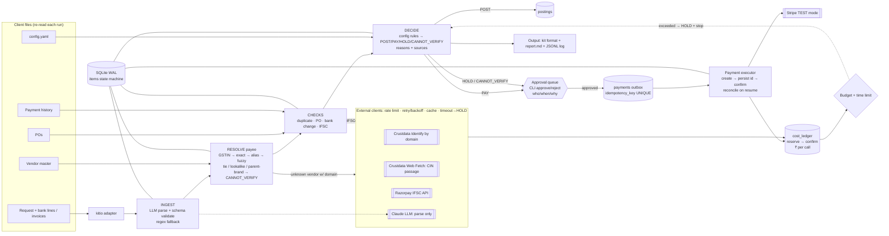

# PLAN.md — "Payables, Replaced": exactly-once AP service for a mid-size Indian 3PL

> Status: FINAL architecture. Major decisions below are not revisited. Owner tags: **Me** (core/pay), **B** (resolve/llm), **C** (checks/decide/tests), **D** (cli/kitio/docs).
> Inputs read: `HACKATHON_INFORMATION.md` (Parts A–D). **Not found in repo:** `AGENTS.md`, kickoff kit, `scratch/api_probe/`. So we design against the official example (Part A) and isolate all kit I/O in `apsvc/kitio/adapter.py`. When the kit arrives, only that file and `config.yaml` paths change.


## 1. Summary (5 lines)
- **Job:** pay each vendor invoice exactly once, post each bank line to the correct payee and account, and catch duplicates and bank-detail fraud. Payables teams and outsourced AP firms are paid to do this today.
- **Who pays:** the 3PL's finance controller, or an outsourced AP firm that runs this for many 3PLs. Priced per item processed.
- **Input:** a request (e.g. "Post these bank lines from October 2026…") plus bank lines or invoices, read against the client's vendor master, POs and payment history (kit files).
- **Finished result:** each item ends in exactly one of: POSTED, PAID (Stripe test mode, after human approval), HELD (with reasons), or CANNOT_VERIFY (naming what is missing). Every fact is sourced. Each run has a cost ledger and a JSONL log.
- **Pass mark:** the 4 official lines give exactly the official results. The hidden set (duplicate, lookalike, unsettleable) never produces a wrong payee or a double post or payment. The kill -9 loop test shows 0 double payments and 0 duplicate ledger, approval or posting rows.

---

## 2. Architecture decisions (chosen · alternatives · why · trade-off)

### 2.1 Overall structure: a staged pipeline over a persistent item state machine
**Chosen:** a single-process CLI. Each item moves through `INGEST → RESOLVE → CHECK → DECIDE → (APPROVE) → EXECUTE`. Each stage is a pure-ish function `(item, ctx) -> StageResult`, and the core commits that result to SQLite before the next stage runs. Stages never write to the DB themselves. Only `core.pipeline` and `pay.executor` write state.
**Alternatives:** (a) an LLM agent loop with tools: rejected because it is non-deterministic and hard to reason about for exactly-once. (b) A queue plus workers (Celery or RQ): rejected as over-built for 7 hours; it is the 100× answer (§2.15).
**Trade-off:** sequential throughput, which is fine for tens to hundreds of items. Determinism and resumability are what get scored.

```
apsvc/
  schemas.py                 # all pydantic models (shared contract)        [Me]
  core/  config.py db.py state.py pipeline.py budget.py ledger.py log.py lock.py crash.py   [Me]
  pay/   base.py fake.py stripe_provider.py executor.py                     [Me]
  resolve/ normalize.py matcher.py http.py crustdata.py webfetch.py ifsc.py [B]
  llm/   parser.py                                                          [B]
  checks/ duplicate.py po.py bank.py runner.py                              [C]
  decide/ engine.py                                                         [C]
  kitio/ adapter.py official_example.py                                     [D]
  cli/   main.py report.py approvals.py                                     [D]
  __main__.py                                                               [D]
config.yaml  db/schema.sql  data/ (client files)  tests/ [C]  docs/ [D]
var/ (db, logs, cache; gitignored)  out/ (results; gitignored)
```
Public functions per module are listed in §4.4.

### 2.2 State store: SQLite in WAL mode, a single file `var/apsvc.db`
**Chosen:** SQLite with `journal_mode=WAL`, `synchronous=FULL` (durable commit before any side effect), and `foreign_keys=ON`. Every state change and its outbox row go in one transaction. The DDL is in §4.2.
**Alternatives:** Postgres (better concurrency, but setup time and nothing gained for one process). JSON files (no atomic multi-row transactions, so exactly-once is impossible).
**Trade-off:** one writer at a time. We enforce one process per DB with an `fcntl.flock` on `var/apsvc.lock`. kill -9 releases the lock automatically.
Every table has `tenant_id`, and every UNIQUE key includes it, so a second client fits (§2.15).

### 2.3 Item state machine
```
NEW ─ingest→ PARSED ─resolve→ RESOLVED ─check→ CHECKED ─decide→ DECIDED
  PARSED/RESOLVED/CHECKED may jump → DECIDED (with outcome CANNOT_VERIFY/HOLD) on hard failure
DECIDED(outcome=POST, approval not required) → POSTING → POSTED*
DECIDED(outcome=PAY)                         → AWAITING_APPROVAL
DECIDED(outcome=HOLD)                        → HELD            (human may: approve --override → APPROVED, or reject)
DECIDED(outcome=CANNOT_VERIFY)               → CANNOT_VERIFY*  (human may only reject/close; can't override into payment)
AWAITING_APPROVAL → APPROVED | REJECTED*
APPROVED → PAYMENT_PENDING → PAYMENT_CREATED → PAYMENT_CONFIRMING → PAID*
                                                                  ↘ PAYMENT_FAILED → HELD
Any non-terminal pre-approval state → STALE (client data changed) → back to PARSED on next run/resume
```
`*` = terminal. A run is complete when no item is in an in-flight state (`NEW, PARSED, RESOLVED, CHECKED, DECIDED, POSTING, APPROVED, PAYMENT_*`). `HELD`, `AWAITING_APPROVAL`, and `CANNOT_VERIFY` are rest states that a person acts on.
`core/state.py` has a static `ALLOWED: dict[State, set[State]]`. `transition()` asserts membership and does `UPDATE items SET state=?, version=version+1 WHERE item_id=? AND state=?`. That is compare-and-swap, so a stale writer fails loudly.
**Persisted before each side effect:**
| Side effect | Persisted first, in the same txn as the state change |
|---|---|
| Crustdata / Web Fetch / IFSC / LLM call | `cost_ledger` row status RESERVED with `call_key` and estimated ₹ |
| Posting | `postings` row (UNIQUE item_id) plus state POSTED, in one txn. Posting is internal, so there is no external side effect |
| Approval request | `approvals` row PENDING (UNIQUE item_id+decision_hash) plus state AWAITING_APPROVAL |
| Stripe create | `payments` row PENDING with `idempotency_key` (UNIQUE) plus state PAYMENT_PENDING |
| Stripe confirm | `payments.provider_ref` (pi id) plus state PAYMENT_CREATED, then state PAYMENT_CONFIRMING |

**Alternatives:** coarse states (NEW/DONE). Rejected because resume would have to redo work and could repeat side effects.

### 2.4 Exactly-once design
- **Item identity:** `item_id = sha256(tenant_id | input_file_sha256 | line_no)[:20]`. Ingest uses `INSERT OR IGNORE`, so re-ingesting on resume creates nothing new.
- **Payment idempotency key:** `idem_key = "ap_" + sha256(tenant_id | vendor_id | invoice_no_canonical | amount_paise | currency)[:32]`. For bank-line payments with no invoice number, `invoice_no_canonical := "line:" + item_id`. If an approver overrides a duplicate hold, the key gets the suffix `|override:<approval_id>`, which makes the override explicit and audited. `payments.idempotency_key` and `payments.item_id` are both UNIQUE. A second item with the same key cannot insert, so it cannot pay twice.
- **Outbox pattern:** `payments` is the outbox. `pay.executor` processes rows in PENDING, CREATED and CONFIRMING. Two Stripe calls, each with its own provider idempotency key:
  1. `PaymentIntent.create(amount, currency="inr", payment_method="pm_card_visa", confirm=False, metadata={idem_key,item_id,vendor_id,tenant_id}, idempotency_key=idem_key+":create")` → persist `provider_ref=pi.id`, status CREATED.
  2. Set status CONFIRMING. Then `PaymentIntent.confirm(pi.id, idempotency_key=idem_key+":confirm")` → persist SUCCEEDED (or FAILED), and set item PAID in the same txn.
- **Reconciliation on resume** (`pay.executor.reconcile()` runs first, before any new stage work):
  - PENDING, no ref: re-send create with the same idempotency key. Stripe returns the original object if the first request landed (keys are valid for 24h). If the row is older than 23h, search first with `metadata['idem_key']:'…'` (search lags about 1 min, so also wait and retry the search twice before creating).
  - CREATED: `retrieve(pi)`. If `requires_confirmation`, confirm. If `succeeded`, mark it.
  - CONFIRMING: `retrieve(pi)`. If `succeeded`, PAID. If `processing`, poll with backoff. If `requires_payment_method` or `canceled`, PAYMENT_FAILED → HELD.
  - Provider unreachable: leave the row as it is, set the item to rest at PAYMENT_* with a reason "provider unreachable; will reconcile", and never mark it PAID or FAILED from silence.
- **Approvals:** UNIQUE(tenant_id, item_id, decision_hash). `approve` runs `UPDATE … SET status='APPROVED' WHERE approval_id=? AND status='PENDING'`, so a second approve is a no-op that says "already approved by X at T". The approval binds to the `decision_hash` (vendor_id, bank hash, amount, outcome, flags). If the decision changes, for example because the vendor master changed, the old approval becomes SUPERSEDED and a new PENDING row is created.
- **Ledger:** `call_key = sha256(run_id | item_id | stage | provider | endpoint | request_hash | attempt)`, UNIQUE. The row is RESERVED before the call. In the same txn as the cache write, it becomes CONFIRMED with the actual credits or tokens. If the process is killed mid-call, the RESERVED row stays and is counted at its estimate. This is conservative: we never under-report spend. On resume the response cache is checked first. A cache hit writes `status=CACHE_HIT, inr=0` under a deterministic key, so there is no new spend. If we really call again, `attempt` is incremented: a genuine second spend, recorded honestly.
- **Crash injection:** `core/crash.py: maybe_crash(point)`. If `APSVC_CRASH_AT == point`, it calls `os._exit(137)`. Points: `after_ingest, after_resolve_reserve, after_resolve_call, after_check, after_decide, after_post_txn, after_pay_pending, after_create_call, after_create_persist, after_confirming, after_confirm_call, after_paid`.

**Kill walkthrough (each boundary):**
| Killed at | DB state on restart | Resume does | Why safe |
|---|---|---|---|
| mid-ingest | some items NEW | INSERT OR IGNORE the rest | item_id is deterministic |
| after ledger RESERVED, before Crustdata call | RESERVED row | cache miss → new attempt row | a spend that never happened is over-counted once at its estimate (conservative, labelled `unconfirmed`) |
| after Crustdata returned, before cache commit | RESERVED | re-call (attempt+1) | real double spend, recorded; no state error |
| after RESOLVED/CHECKED/DECIDED commit | state = that | continue from next stage | stages are pure; re-running is harmless |
| after decide, before approval row | DECIDED | creates approval row (same txn as AWAITING_APPROVAL) | UNIQUE on approval |
| mid-posting txn | rolled back → DECIDED | post again | posting row and state are one txn |
| after PAYMENT_PENDING, before create | PENDING, no ref | create with same idem key | Stripe idempotency |
| after create landed, before ref persisted | PENDING, no ref | create again with same key → same pi returned | Stripe idempotency (24h) / metadata search |
| after CREATED, before confirm | CREATED | retrieve → confirm with `:confirm` key | confirm idempotency |
| after confirm landed, before persist | CONFIRMING | retrieve → succeeded → PAID | we read provider truth, not our assumption |
| after PAID | terminal | nothing | — |

### 2.5 Payment provider: **Stripe test mode**, behind `PaymentProvider`
**Chosen:** Stripe. You only need an `sk_test_…` key. It has first-class `Idempotency-Key` on every POST, `PaymentIntent.retrieve` and `search` by metadata for lookup, and `Refund.create` for reversal. It runs fully server-side.
**Alternatives:** (a) Razorpay test mode: a server-side payment needs Checkout (client-side) to capture, and Payments has no general idempotency header. (b) RazorpayX Payouts: the right semantics for paying vendors to a bank account plus IFSC, with an `X-Payout-Idempotency` header. But activation and KYC risk is high on the day.
**Trade-off:** a Stripe PaymentIntent is semantically a charge, not a vendor payout. We say so openly. `RazorpayXPayoutProvider` is the production adapter, a stub that implements the same interface. `FakeProvider` is SQLite-backed and has its own file (it simulates provider-side memory across our crashes). It is used in tests and the kill loop.
Interface: `create(idem_key, amount_paise, currency, metadata) -> ProviderPayment`, `confirm(ref, idem_key) -> ProviderPayment`, `retrieve(ref) -> ProviderPayment`, `find_by_idem_key(idem_key) -> ProviderPayment|None`, `refund(ref, idem_key)`.
Risk: if INR PaymentIntents fail on our Stripe account, set `payments.currency_override: usd` in config and keep the INR amount in metadata. Task M8 probes this first thing.

### 2.6 Payee resolution algorithm (`resolve/`)
**Normalisation** (`normalize.descriptor_key`): Unicode NFKC → uppercase → strip the configured processor prefixes (regex list: `^RAZ\*`, `^PAYTM\*`, `^NEFT[-/ ]`, `^IMPS[-/ ]`, `^UPI[-/ ]`, `^POS `, `^ACH `, `^BIL/`, and trailing `/\d+` refs) → strip trailing configured city tokens (`BLR, BANGALORE, BENGALURU, MUM, MUMBAI, DEL, DELHI, GGN, GURGAON, CHN, HYD, PUNE, KOL`) → punctuation to space → collapse whitespace. `name_key` also drops legal suffixes (`PVT, PRIVATE, LTD, LIMITED, LLP, INC, SARL, GMBH, CO`) and expands the configured abbreviations (`TRD→TRADERS, LOGS→LOGISTICS`). Region tokens like `EMEA` are **not** stripped, because they distinguish legal entities.
**Matching order** (stop at the first level that yields candidates):
1. **Identifier exact:** GSTIN, then CIN, then remit bank-account hash (invoices only).
2. **Name exact:** `name_key == vendor.name_key`.
3. **Alias exact:** `descriptor_key` or `name_key` ∈ the vendor's `aliases` (from the vendor master, plus the config `aliases_extra`).
4. **Fuzzy:** `rapidfuzz.fuzz.ratio` (not `token_set_ratio`, because token_set scores "DELHIVERY LOGISTICS" ⊇ "DELHIVERY" at 100).
   - The best score must be ≥ `fuzzy.min_score` (92) **and** beat the 2nd best by ≥ `fuzzy.min_margin` (5), giving FUZZY_MATCH. This is **never auto-executed**: the decision is HOLD with "probable match V-xxx; confirm".
   - Otherwise, if either string's tokens are a strict superset or subset of the other, or the score is ≥ `fuzzy.lookalike_floor` (75), the flag is LOOKALIKE and the decision is CANNOT_VERIFY, naming the candidate and the differing tokens.
- **Tie rule:** more than 1 distinct vendor_id at the winning level (or fuzzy margin < 5) → `PAYEE_TIE` → CANNOT_VERIFY, listing the candidates.
- **No match:** if a domain is known (invoice `domain` field or email domain, or a domain inside the descriptor), call **Crustdata Identify by domain** (never by name: Part C shows three "Sharma Traders" all at 1.0). Then **Web Fetch** the configured paths (`/`, `/contact-us`, `/about-us`) and regex for a CIN (`[LU]\d{5}[A-Z]{2}\d{4}[A-Z]{3}\d{6}`) plus a legal name in the same passage (±200 chars, e.g. "© 2026 Delhivery Limited").
  - The passage contains both legal name and CIN: `NEW_VENDOR_VERIFIED`. The payee for a POST is sourced from the passage. A PAY is always HOLD "vendor onboarding required", because there is no trusted bank details source.
  - **Parent-brand rule:** the entity on the invoice (e.g. "Amazon Web Services EMEA SARL") ≠ the entity in the Crustdata name or web passage (e.g. "Amazon Web Services (AWS)", US) → `PARENT_BRAND` → CANNOT_VERIFY, unless the vendor master has the exact entity, which levels 1–3 would already have matched.
  - No domain → **no paid call**. The result is `PAYEE_UNRESOLVED` → CANNOT_VERIFY with "missing: vendor-master record or a domain/GSTIN identifying the payee". This is the official PAYTM*SHARMA TRD case, at zero credits.
- Sites on the `webfetch.skip_domains` list (zaubacorp, filesure, any domain that previously returned "Just a moment") are skipped before the call. A response containing "Just a moment" / `cf-chl` adds the domain to `domain_blocklist` in the DB.
- **Caching:** `http_cache` table keyed by (provider, endpoint, request_hash), with TTL per provider from config (Crustdata 7d, Web Fetch 1d, IFSC 30d, LLM ∞ keyed by prompt+model hash).
**Alternatives:** an embedding similarity or LLM judge for names (rejected: non-deterministic, unexplainable). Trusting Crustdata name match (rejected per Part C).
**Trade-off:** more items go to HOLD or CANNOT_VERIFY. That matches the rule that a wrong answer is worse than "cannot verify".

### 2.7 Checks (`checks/`), each returning `CheckResult{status: PASS|FLAG|ERROR, flags, reasons, sources}`
- **Duplicate** (`checks/duplicate.py`). Two keys, checked against (a) earlier items in this request (order = date, then line_no), (b) POSTED/PAID/AWAITING items in the DB for this tenant, and (c) the client payment-history file, if the kit has one.
  - K1 `invoice_no_canonical` + vendor_id. Canonicalisation: uppercase → split into alnum groups → drop configured noise tokens (`INV, INVOICE, BILL, NO, NUM, #`) → drop FY tokens matching `20\d\d-\d\d|\d\d-\d\d` when configured → `int()` each numeric group (removes leading zeros) → join with `|`. So `INV-2026/00042`, `inv 2026-42`, and `2026/42` → `2026|42`.
  - K2 vendor_id (or descriptor_key if unresolved) + amount_paise + |date diff| ≤ `duplicate.window_days` (3).
  - Either hit gives `DUPLICATE_SUSPECTED` → HOLD, with a reason citing the earlier item's input ref. The first occurrence proceeds. The later one is held "for approval as a possible duplicate". This is the official AWS case.
- **PO match** (`checks/po.py`): `po.required_for` (default `[PAY]`). Missing PO → `PO_MISSING`. PO not found → `PO_NOT_FOUND`. PO vendor ≠ resolved vendor → `PO_VENDOR_MISMATCH`. |inv − po| > max(`tolerance_pct`×po, `tolerance_abs_inr`) → `PO_AMOUNT_MISMATCH`. Qty likewise. All of these HOLD. PO already fully billed → `PO_EXHAUSTED`.
- **Bank** (`checks/bank.py`):
  - Invoice remit bank hash ≠ vendor master bank hash, or the IFSC differs → `BANK_CHANGED` → **always HOLD**. This cannot be overridden into payment from the CLI: the vendor master must be updated after a call-back to a known contact.
  - Then call the Razorpay IFSC API for the new IFSC to add bank and branch facts (with source = HTTP Date header). A 404 adds `IFSC_INVALID`.
  - Before every PAY, verify the vendor-master IFSC too. This is free and is the live-data decision point. A 404 → `IFSC_INVALID` → HOLD.
  - A standalone `VENDOR_MESSAGE` item ("we changed our bank account") → `BANK_CHANGE_REQUEST` → HOLD. We never write to the vendor master.
- **Timeouts and errors:** every external call has `timeout_s`, plus `retries` with exponential backoff and jitter. On final failure the check returns status ERROR with the flag `SOURCE_UNAVAILABLE:<provider>` → HOLD "could not reach X after N attempts; not guessing". A check never returns PASS on error.

### 2.8 Decision engine (`decide/engine.py`): pure function of flags + config
**Format:** checks and resolution emit **flag codes** (closed enum in `schemas.Flag`). In config, `decision.rules` is a list of `{id, flags_any: [...], outcome: HOLD|CANNOT_VERIFY, reason: "template {vars}", overridable: bool}`.
**Algorithm:** collect all flags, then for every rule that matches, add its reason (all reasons, not first-match, so the approver sees everything). The outcome is the most severe: `CANNOT_VERIFY > HOLD > default_action`. `default_action` = the request intent (`POST` or `PAY`). `sources` = the union of resolution and check sources, de-duplicated by (fact, ref). `missing[]` comes from rules that declare `missing: "..."`.
**Consistency guarantee:** `decide()` reads only the normalized `Facts` (vendor_id, amount_paise, date, canonical invoice no, flags) and `config_hash`. It never sees raw text. The LLM output goes through schema validation and normalization before Facts exist. So two wordings that normalize the same give byte-identical decisions. `decision_hash = sha256(canonical_json(facts) + config_hash)`. Test T-CONSIST asserts this.
**Account posting:** `accounts.by_vendor` (vendor-master `default_account` column) → `accounts.by_category` (vendor category → GL account) → else `ACCOUNT_UNMAPPED` → HOLD. The source is the vendor-master field or the config rule id.
**Alternatives:** a rules engine library or an embedded expression DSL (more power, risk of eval, slower to explain). An LLM decision (rejected by constraint).

### 2.9 Config design (`config.yaml`, re-read and hashed on every `run`/`resume`)
Full keys are in §4.3. Rehearsed changes:
- **Lower cost limit:** `limits.cost_inr_per_run: 25 → 10` (1 line).
- **New output field**, e.g. `payee_gstin`: add `- payee_gstin` under `output.fields` (1 line). If the value isn't already computed, add one getter in `kitio/adapter.py: FIELD_GETTERS["payee_gstin"] = lambda r: r.payee.gstin if r.payee else None` (1 line).
- **New rule:** append a `decision.rules` entry (3 lines). A new flag needs one enum value plus emitting it in one check.
- Client data paths live under `client.*`. Files are re-read every run, and their sha256 goes into `runs.client_data_hash`.

### 2.10 Output (`kitio/adapter.py` is the only kit-format-aware file)
- `load_request(path) -> Request` (intent + items) and `write_results(results, path)` in the kit format. Until the kit is found: input = a JSON/CSV of the official example columns (`date, descriptor, amount_inr`), output = JSONL plus `out/<run_id>/report.md`.
- Output record (draft, field order from `output.fields`): `item_ref, date, descriptor, amount_inr, outcome (POSTED|PAID|AWAITING_APPROVAL|HELD|CANNOT_VERIFY|REJECTED), payee_legal_name, vendor_id, account, reasons[], missing[], sources[], approval{status,by,at,reason}, payment{provider,ref,idempotency_key,status}, cost_inr`.
- Human report lines, rendered from Source:
  - "Payee **Swiggy Limited**, from the `legal_name` field of vendor-master record V-0012 (`data/vendor_master.csv`, record dated 2026-09-30), retrieved 2026-11-22 12:03 IST."
  - "**CANNOT VERIFY**: no source identifies the payee for 'PAYTM*SHARMA TRD'. Missing: vendor-master record or a GSTIN/domain. Held for a person."

### 2.11 Cost ledger + limits (`core/ledger.py`, `core/budget.py`)
- **Per call:** call_key, run_id, item_id, stage, provider, endpoint, unit_type (`credits|tokens_in|tokens_out|call`), units, est_inr, inr, status (RESERVED|CONFIRMED|FAILED|CACHE_HIT), http_status, latency_ms, request_hash, ts.
  - Crustdata units come from the response credit info, falling back to `costs.crustdata.estimates[endpoint]`.
  - LLM units come from `usage.input_tokens/output_tokens`.
  - Stripe and IFSC record ₹0 actual, plus `costs.notional.stripe_fee_pct` for the finance view.
- **Conversion** from config: `costs.crustdata.inr_per_credit`, `costs.llm.<model>.inr_per_mtok_in/out` (fill from the official Anthropic pricing page, not from memory), `costs.infra_inr_per_item`.
- **Enforcement:** `budget.reserve(est_inr)` raises `BudgetExceeded` if `confirmed + reserved + est > limits.cost_inr_per_run`. The caller turns that into the flag `COST_LIMIT` → HOLD "cost limit reached before verification". After that, no more paid calls. The remaining items still finish their free stages and get an honest HOLD, so every item has an output.
- **Time limit:** `limits.time_s_per_invocation` is checked between stages. On expiry: stop cleanly, set run status PARTIAL, `resume` continues. Hard wall limit `limits.call_timeout_s` per HTTP call.
- `ledger` CLI shows per run: totals by provider, ₹ per item, and ₹ per finished item (the measured cost of each job).

### 2.12 Logging (`core/log.py`)
JSONL at `var/logs/<run_id>.jsonl`. Every line has `{ts, run_id, session_id, item_id?, event, stage?, state_from?, state_to?, data}`. Events: `run_start, config_loaded(hash), client_data_loaded(hash), item_ingested, stage_start, stage_done, transition, ext_call_start, ext_call_done(status, latency, credits), retry(attempt, wait), cache_hit, decision(outcome, flags, rule_ids), approval_requested, approval_decided, payment_outbox, payment_provider_call, payment_reconciled, budget_reserve, budget_exceeded, crash_recovered, run_end(summary)`.
`session_id` changes on each restart, so judges can see recovery. Bank numbers appear only as last4. `out/<run_id>/summary.md` has counts by outcome, ₹ total, ₹/item, retries, recoveries and open approvals.

### 2.13 Approval flow (`cli/approvals.py`)
- `apsvc approvals [--run R]` lists PENDING and HELD items. Each shows: amount, payee (with source), bank last4 plus IFSC bank and branch, outcome, every reason, every source line, and the flags that can be overridden.
- `apsvc approve <item_id> --by <name> [--reason "…"] [--override FLAG…]` updates the approval for the current decision_hash only. An override requires `--reason`. `BANK_CHANGED`, `PARENT_BRAND`, `PAYEE_TIE`, `LOOKALIKE`, and `PAYEE_UNRESOLVED` are never overridable. Then the item → APPROVED, and the executor runs (or the next `resume` does).
- `apsvc reject <item_id> --by <name> --reason "…"` → REJECTED.
- **Audit:** the `approvals` row (who, when, why, decision_hash, overrides) plus a JSONL event. `--by` defaults to `$USER`. There is no self-approval bypass flag.

### 2.14 External clients (`resolve/http.py` base, used by all)
- `ExtClient.call(provider, endpoint, method, url, body, *, item_id, stage)`: cache lookup → `budget.reserve` → per-endpoint token-bucket limiter (Crustdata identify 30/min, enrich 15/min, web 10/min, from config) → httpx with timeout → classify the result:
  - 2xx: commit cache plus ledger CONFIRMED.
  - 429: sleep until `x-ratelimit-reset` (capped), then retry.
  - 5xx or timeout: backoff and retry.
  - 402: `CREDITS_EXHAUSTED`, no retry → HOLD flag.
  - 401/403: `SOURCE_UNAVAILABLE` plus a loud log.
- `crustdata.identify_by_domain(domain)`, `webfetch.fetch(url)` (endpoint path to be confirmed by B from docs.crustdata.com/llms.txt at T+0, because `scratch/api_probe` is missing), `ifsc.lookup(ifsc)` (`GET https://ifsc.razorpay.com/<IFSC>`, the record_date is the HTTP `Date` header), `llm.parse_invoice(text)`.
- The LLM (Anthropic, model from config, temperature 0) uses structured JSON output validated by pydantic. On failure it retries once with the validation error, then falls back to a regex parser. If both fail → `PARSE_FAILED` → CANNOT_VERIFY. Emails and phone numbers are redacted before sending.
- Every client is a `Protocol`. Tests inject `Fake*` clients with scripted responses (latency, 429, 402, timeout).

### 2.15 Scale / second client
- **100× volume:** SQLite → Postgres with the same DDL. Stages become workers claiming items with `SELECT … FOR UPDATE SKIP LOCKED`. The outbox poller is a separate worker. The cache and rate limiter move to Redis (a shared token bucket per Crustdata endpoint). Use batch Identify (domains array). Idempotency keys already make retries safe. A vendor-master in-memory index keeps matching at O(1) for exact matches.
- **Second client:** `tenant_id` is already on every row and in every UNIQUE key. Use `clients/<tenant>/config.yaml` plus their files, selected with `--tenant` (default from config). No code changes.

---

## 3. Architecture diagram (goes into README)


---

## 4. Exact interfaces

### 4.1 `apsvc/schemas.py` (pydantic v2; money is always integer paise)
```python
class State(StrEnum): NEW, PARSED, RESOLVED, CHECKED, DECIDED, POSTING, POSTED, AWAITING_APPROVAL, APPROVED,
    PAYMENT_PENDING, PAYMENT_CREATED, PAYMENT_CONFIRMING, PAID, PAYMENT_FAILED, HELD, CANNOT_VERIFY, REJECTED, STALE
class Intent(StrEnum): POST, PAY, RECONCILE
class Outcome(StrEnum): POST, PAY, HOLD, CANNOT_VERIFY
class ItemKind(StrEnum): BANK_LINE, INVOICE, VENDOR_MESSAGE
class Flag(StrEnum): PAYEE_UNRESOLVED, PAYEE_TIE, LOOKALIKE, FUZZY_MATCH, PARENT_BRAND, NEW_VENDOR_VERIFIED,
    DUPLICATE_SUSPECTED, PO_MISSING, PO_NOT_FOUND, PO_VENDOR_MISMATCH, PO_AMOUNT_MISMATCH, PO_QTY_MISMATCH, PO_EXHAUSTED,
    BANK_CHANGED, BANK_CHANGE_REQUEST, IFSC_INVALID, ACCOUNT_UNMAPPED, SOURCE_UNAVAILABLE, CREDITS_EXHAUSTED,
    COST_LIMIT, PARSE_FAILED, VENDOR_ONBOARDING_REQUIRED

class Source(BaseModel):
    fact: str                      # "payee.legal_name", "account", "ifsc.branch", "duplicate.of"
    value: str
    source: str                    # vendor_master | po_file | payment_history | crustdata.identify | crustdata.web_fetch | razorpay.ifsc | stripe | config
    ref: str                       # record id, URL, or file:line
    field_or_passage: str          # field name, or exact quoted passage (validator: value must appear in passage for web sources)
    record_date: date | None
    record_date_basis: Literal["record_field","http_date_header","file_mtime","fetch_time","unknown"]
    retrieved_at: datetime

class Reason(BaseModel): code: Flag | str; text: str; rule_id: str | None = None
class BankLine(BaseModel): date: date; descriptor: str; amount_paise: int; currency: str = "INR"; direction: Literal["debit","credit"] = "debit"; ref: str | None = None
class Invoice(BaseModel):
    vendor_name_raw: str; gstin: str | None; invoice_no: str; invoice_no_canonical: str; invoice_date: date
    amount_paise: int; currency: str = "INR"; po_number: str | None; qty: float | None
    remit_bank_hash: str | None; remit_bank_last4: str | None; remit_ifsc: str | None; domain: str | None
class VendorMessage(BaseModel): vendor_name_raw: str; domain: str | None; received_at: datetime; kind: Literal["BANK_CHANGE","OTHER"]; new_bank_hash: str | None; new_bank_last4: str | None; new_ifsc: str | None
class Item(BaseModel):
    item_id: str; tenant_id: str; run_id: str; kind: ItemKind; line_no: int; input_ref: str; intent: Intent
    state: State; version: int; payload: BankLine | Invoice | VendorMessage; raw_text_sha: str
class Vendor(BaseModel):
    vendor_id: str; legal_name: str; name_key: str; aliases: list[str]; cin: str | None; gstin: str | None
    bank_hash: str | None; bank_last4: str | None; ifsc: str | None; default_account: str | None
    category: str | None; domain: str | None; record_date: date | None; record_ref: str
class PO(BaseModel): po_number: str; vendor_id: str; amount_paise: int; qty: float | None; billed_paise: int = 0; status: str; record_date: date | None; record_ref: str
class Resolution(BaseModel):
    status: Literal["RESOLVED","FUZZY","UNRESOLVED","TIE","LOOKALIKE","PARENT_BRAND","NEW_VENDOR_VERIFIED","ERROR"]
    vendor_id: str | None; legal_name: str | None; method: Literal["gstin","cin","bank","exact","alias","fuzzy","web","none"]
    score: float | None; candidates: list[tuple[str, float]]; flags: list[Flag]; sources: list[Source]
class CheckResult(BaseModel): name: str; status: Literal["PASS","FLAG","ERROR"]; flags: list[Flag]; reasons: list[Reason]; sources: list[Source]
class Facts(BaseModel): intent: Intent; kind: ItemKind; vendor_id: str | None; amount_paise: int; date: date; invoice_no_canonical: str | None; account: str | None; flags: list[Flag]  # sorted
class Decision(BaseModel):
    item_id: str; outcome: Outcome; flags: list[Flag]; reasons: list[Reason]; sources: list[Source]
    missing: list[str]; rule_ids: list[str]; overridable: list[Flag]; config_hash: str; decision_hash: str; decided_at: datetime
class Approval(BaseModel):
    approval_id: str; item_id: str; decision_hash: str; status: Literal["PENDING","APPROVED","REJECTED","SUPERSEDED"]
    requested_at: datetime; decided_by: str | None; decided_at: datetime | None; reason: str | None; overrides: list[Flag]
class Payment(BaseModel):
    payment_id: str; item_id: str; idempotency_key: str; provider: str; provider_ref: str | None; amount_paise: int; currency: str
    status: Literal["PENDING","CREATED","CONFIRMING","SUCCEEDED","FAILED"]; last_error: str | None; created_at: datetime; updated_at: datetime
class LedgerEntry(BaseModel):
    call_key: str; run_id: str; item_id: str | None; stage: str; provider: str; endpoint: str
    unit_type: Literal["credits","tokens_in","tokens_out","call"]; units: float; est_inr: float; inr: float | None
    status: Literal["RESERVED","CONFIRMED","FAILED","CACHE_HIT"]; http_status: int | None; latency_ms: int | None; request_hash: str; ts: datetime
class ItemResult(BaseModel): item: Item; decision: Decision | None; resolution: Resolution | None; approval: Approval | None; payment: Payment | None; cost_inr: float
class RunConfig(BaseModel): ...  # mirrors config.yaml (§4.3) one-to-one; extra="forbid" so typos fail fast
```

### 4.2 `db/schema.sql`
```sql
PRAGMA journal_mode=WAL; PRAGMA synchronous=FULL; PRAGMA foreign_keys=ON;
CREATE TABLE runs (run_id TEXT PRIMARY KEY, tenant_id TEXT NOT NULL, request_path TEXT, request_sha TEXT NOT NULL,
  intent TEXT NOT NULL, config_hash TEXT NOT NULL, client_data_hash TEXT NOT NULL, status TEXT NOT NULL
  CHECK(status IN('RUNNING','PARTIAL','COMPLETE','STOPPED_COST','STOPPED_TIME')), started_at TEXT NOT NULL, updated_at TEXT NOT NULL,
  UNIQUE(tenant_id, request_sha));                 -- same request file ⇒ same run (resume, not duplicate)
CREATE TABLE sessions (session_id TEXT PRIMARY KEY, run_id TEXT NOT NULL REFERENCES runs, started_at TEXT NOT NULL, pid INTEGER, kind TEXT);
CREATE TABLE items (item_id TEXT PRIMARY KEY, tenant_id TEXT NOT NULL, run_id TEXT NOT NULL REFERENCES runs, kind TEXT NOT NULL,
  line_no INTEGER NOT NULL, input_ref TEXT NOT NULL, intent TEXT NOT NULL, state TEXT NOT NULL, version INTEGER NOT NULL DEFAULT 0,
  payload_json TEXT NOT NULL, raw_text_sha TEXT NOT NULL, vendor_id TEXT, amount_paise INTEGER, item_date TEXT,
  invoice_no_canonical TEXT, descriptor_key TEXT, resolution_json TEXT, checks_json TEXT, decision_json TEXT, decision_hash TEXT,
  outcome TEXT, updated_at TEXT NOT NULL, UNIQUE(run_id, line_no));
CREATE INDEX ix_items_state ON items(tenant_id, state);
CREATE INDEX ix_items_dup_inv ON items(tenant_id, vendor_id, invoice_no_canonical);
CREATE INDEX ix_items_dup_amt ON items(tenant_id, vendor_id, amount_paise, item_date);
CREATE INDEX ix_items_dup_desc ON items(tenant_id, descriptor_key, amount_paise, item_date);
CREATE TABLE postings (posting_id TEXT PRIMARY KEY, tenant_id TEXT NOT NULL, item_id TEXT NOT NULL UNIQUE REFERENCES items,
  vendor_id TEXT, account TEXT NOT NULL, amount_paise INTEGER NOT NULL, posted_at TEXT NOT NULL);
CREATE TABLE approvals (approval_id TEXT PRIMARY KEY, tenant_id TEXT NOT NULL, item_id TEXT NOT NULL REFERENCES items,
  decision_hash TEXT NOT NULL, status TEXT NOT NULL CHECK(status IN('PENDING','APPROVED','REJECTED','SUPERSEDED')),
  requested_at TEXT NOT NULL, decided_by TEXT, decided_at TEXT, reason TEXT, overrides_json TEXT NOT NULL DEFAULT '[]',
  UNIQUE(tenant_id, item_id, decision_hash));
CREATE INDEX ix_approvals_status ON approvals(tenant_id, status);
CREATE TABLE payments (payment_id TEXT PRIMARY KEY, tenant_id TEXT NOT NULL, item_id TEXT NOT NULL UNIQUE REFERENCES items,
  approval_id TEXT NOT NULL REFERENCES approvals, idempotency_key TEXT NOT NULL UNIQUE, provider TEXT NOT NULL, provider_ref TEXT UNIQUE,
  amount_paise INTEGER NOT NULL, currency TEXT NOT NULL, status TEXT NOT NULL CHECK(status IN('PENDING','CREATED','CONFIRMING','SUCCEEDED','FAILED')),
  last_error TEXT, created_at TEXT NOT NULL, updated_at TEXT NOT NULL);
CREATE INDEX ix_payments_open ON payments(status) WHERE status IN('PENDING','CREATED','CONFIRMING');
CREATE TABLE cost_ledger (call_key TEXT PRIMARY KEY, tenant_id TEXT NOT NULL, run_id TEXT NOT NULL, item_id TEXT, stage TEXT NOT NULL,
  provider TEXT NOT NULL, endpoint TEXT NOT NULL, unit_type TEXT NOT NULL, units REAL NOT NULL DEFAULT 0, est_inr REAL NOT NULL,
  inr REAL, status TEXT NOT NULL CHECK(status IN('RESERVED','CONFIRMED','FAILED','CACHE_HIT')), http_status INTEGER, latency_ms INTEGER,
  request_hash TEXT NOT NULL, attempt INTEGER NOT NULL, ts TEXT NOT NULL);
CREATE INDEX ix_ledger_run ON cost_ledger(run_id, provider);
CREATE TABLE http_cache (provider TEXT NOT NULL, endpoint TEXT NOT NULL, request_hash TEXT NOT NULL, status INTEGER NOT NULL,
  headers_json TEXT, body TEXT NOT NULL, retrieved_at TEXT NOT NULL, expires_at TEXT, PRIMARY KEY(provider, endpoint, request_hash));
CREATE TABLE domain_blocklist (domain TEXT PRIMARY KEY, reason TEXT NOT NULL, added_at TEXT NOT NULL);
```

### 4.3 `config.yaml`
```yaml
tenant_id: acme3pl                     # replaced from kit
client:
  vendor_master: data/vendor_master.csv
  purchase_orders: data/purchase_orders.csv
  payment_history: data/payment_history.csv     # optional; missing file = empty
  accounts_chart: data/chart_of_accounts.csv    # optional
  vendor_master_columns: [vendor_id, legal_name, aliases, cin, gstin, bank_account, ifsc, default_account, category, domain, last_updated]
  record_date_column: last_updated
limits:
  time_s_per_invocation: 600
  cost_inr_per_run: 25.0
  cost_inr_per_item: 5.0
  call_timeout_s: 20
request_intents: {POST: [post, categori, book, account], PAY: [pay, settle, remit], RECONCILE: [reconcile, match]}
normalize:
  processor_prefixes: ['^RAZ\*', '^PAYTM\*', '^NEFT[-/ ]', '^IMPS[-/ ]', '^UPI[-/ ]', '^POS ', '^ACH ', '^BIL/']
  city_tokens: [BLR, BANGALORE, BENGALURU, MUM, MUMBAI, DEL, DELHI, GGN, GURGAON, CHN, CHENNAI, HYD, PUNE, KOL]
  legal_suffixes: [PVT, PRIVATE, LTD, LIMITED, LLP, INC, SARL, GMBH, CO]
  abbreviations: {TRD: TRADERS, LOGS: LOGISTICS, SVCS: SERVICES}
  invoice_noise_tokens: [INV, INVOICE, BILL, NO, NUM]
  strip_fy_tokens: false
match:
  fuzzy_min_score: 92
  fuzzy_min_margin: 5
  lookalike_floor: 75
  aliases_extra: {}                    # vendor_id: [alias, ...]
duplicate: {window_days: 3, compare_against: [this_request, db_history, payment_history]}
po: {required_for: [PAY], tolerance_pct: 1.0, tolerance_abs_inr: 100, qty_tolerance_pct: 0}
bank: {verify_ifsc_before_pay: true, bank_change_overridable: false}
accounts:
  by_category: {food: "Staff meals", cloud: "Cloud hosting", freight: "Freight - carriers", fuel: "Fuel"}
decision:
  severity: [CANNOT_VERIFY, HOLD]
  rules:
    - {id: R01, flags_any: [PAYEE_UNRESOLVED], outcome: CANNOT_VERIFY, reason: "No source identifies the payee for '{descriptor}'", missing: "vendor-master record or GSTIN/domain", overridable: false}
    - {id: R02, flags_any: [PAYEE_TIE], outcome: CANNOT_VERIFY, reason: "Several vendors match equally: {candidates}", overridable: false}
    - {id: R03, flags_any: [LOOKALIKE], outcome: CANNOT_VERIFY, reason: "'{descriptor}' resembles {candidate} but differs ({diff}); not merging", overridable: false}
    - {id: R04, flags_any: [PARENT_BRAND], outcome: CANNOT_VERIFY, reason: "Domain resolves to {found_entity}, not billed entity {billed_entity}", overridable: false}
    - {id: R05, flags_any: [PARSE_FAILED], outcome: CANNOT_VERIFY, reason: "Could not parse input", overridable: false}
    - {id: R10, flags_any: [DUPLICATE_SUSPECTED], outcome: HOLD, reason: "Possible duplicate of {dup_ref}", overridable: true}
    - {id: R11, flags_any: [BANK_CHANGED, BANK_CHANGE_REQUEST], outcome: HOLD, reason: "Bank details differ from vendor master (possible fraud); verify by call-back", overridable: false}
    - {id: R12, flags_any: [IFSC_INVALID], outcome: HOLD, reason: "IFSC {ifsc} not found at Razorpay IFSC", overridable: false}
    - {id: R13, flags_any: [PO_MISSING, PO_NOT_FOUND, PO_VENDOR_MISMATCH, PO_AMOUNT_MISMATCH, PO_QTY_MISMATCH, PO_EXHAUSTED], outcome: HOLD, reason: "PO check failed: {po_detail}", overridable: true}
    - {id: R14, flags_any: [FUZZY_MATCH], outcome: HOLD, reason: "Probable match {candidate} ({score}); confirm", overridable: true}
    - {id: R15, flags_any: [VENDOR_ONBOARDING_REQUIRED, NEW_VENDOR_VERIFIED], outcome: HOLD, reason: "Vendor not in master; onboarding required before payment", overridable: false, applies_to: [PAY]}
    - {id: R16, flags_any: [SOURCE_UNAVAILABLE, CREDITS_EXHAUSTED], outcome: HOLD, reason: "Source {provider} unavailable after retries; not guessing", overridable: false}
    - {id: R17, flags_any: [COST_LIMIT], outcome: HOLD, reason: "Run cost limit reached before verification", overridable: false}
    - {id: R18, flags_any: [ACCOUNT_UNMAPPED], outcome: HOLD, reason: "No account mapping for vendor {vendor_id}", overridable: true}
actions: {POST: {requires_approval: false}, PAY: {requires_approval: true}}
payments:
  provider: stripe                     # stripe | fake | razorpayx
  currency: INR
  currency_override: null              # e.g. usd if INR PI fails on our test account
  test_payment_method: pm_card_visa
  idem_key_window_h: 23
crustdata:
  base_url: https://api.crustdata.com
  api_version: "2025-11-01"
  rate_per_min: {identify: 30, enrich: 15, web_search: 10, web_fetch: 10}
  retries: 3
  backoff_base_s: 1.0
  identify_by: domain                  # never name
webfetch: {paths: ["/", "/contact-us", "/about-us"], skip_domains: [zaubacorp.com, filesure.in], cf_markers: ["Just a moment", "cf-chl"]}
ifsc: {base_url: https://ifsc.razorpay.com, retries: 2}
llm: {provider: anthropic, model: claude-haiku-5-5, temperature: 0, max_tokens: 1024, retries: 1, redact: [email, phone]}
cache_ttl_h: {crustdata: 168, web_fetch: 24, ifsc: 720, llm: null}
costs:
  crustdata: {inr_per_credit: 0.0, estimates: {identify: 0.2, enrich: 2, web_search: 1, web_fetch: 1}}   # FILL inr_per_credit from Crustdata pricing
  llm: {claude-haiku-5-5: {inr_per_mtok_in: 0.0, inr_per_mtok_out: 0.0}}                                  # FILL from Anthropic pricing page
  infra_inr_per_item: 0.05
  notional: {stripe_fee_pct: 2.0}
output:
  format: jsonl                        # kit adapter decides
  path: out/{run_id}/results.jsonl
  report: out/{run_id}/report.md
  fields: [item_ref, date, descriptor, amount_inr, outcome, payee_legal_name, vendor_id, account, reasons, missing, sources, approval, payment, cost_inr]
logging: {dir: var/logs, mask_bank: true}
storage: {db_path: var/apsvc.db, lock_path: var/apsvc.lock, fake_provider_db: var/fake_provider.db}
```

### 4.4 Module signatures
```python
# core/config.py
def load_config(path="config.yaml") -> tuple[RunConfig, str]        # (cfg, config_hash)
def load_client_data(cfg) -> tuple[ClientData, str]                  # vendors, pos, history; client_data_hash
# core/db.py
def connect(path) -> sqlite3.Connection;  def migrate(conn) -> None;  def tx(conn) -> ContextManager
# core/state.py
ALLOWED: dict[State, set[State]];  def transition(conn, item_id, frm: State, to: State, **cols) -> None  # CAS; raises IllegalTransition/StaleWrite
# core/pipeline.py
def start_run(request_path, cfg, cfg_hash, data, data_hash) -> str   # idempotent on request_sha
def drive(run_id, ctx: RunContext) -> RunSummary                     # loop: reconcile payments → advance each non-rest item one stage → until none in-flight / limit
def mark_stale_if_data_changed(run_id, data_hash) -> int
# core/budget.py
class Budget: def reserve(self, est_inr: float) -> None; def remaining(self) -> float; def check_time(self) -> None
# core/ledger.py
def reserve(conn, call: LedgerEntry) -> str;  def confirm(conn, call_key, units, inr, http_status, latency_ms) -> None
def fail(conn, call_key, http_status) -> None;  def record_cache_hit(conn, ...) -> None;  def summary(conn, run_id) -> LedgerSummary
# core/log.py   def event(name: str, **data) -> None   (bound to run_id/session_id)
# core/lock.py  def single_instance(lock_path) -> ContextManager
# core/crash.py def maybe_crash(point: str) -> None
# pay/base.py   class PaymentProvider(Protocol): create, confirm, retrieve, find_by_idem_key, refund
# pay/executor.py
def make_idem_key(tenant_id, vendor_id, invoice_no_canonical, amount_paise, currency, override_approval_id=None) -> str
def enqueue(conn, item, approval) -> Payment        # inserts PENDING + item→PAYMENT_PENDING in one txn
def process(conn, provider, payment) -> Payment     # PENDING→CREATED→CONFIRMING→SUCCEEDED
def reconcile(conn, provider) -> list[Payment]      # run first on every run/resume
# resolve/normalize.py  def descriptor_key(s, cfg) -> str; def name_key(s, cfg) -> str; def invoice_canonical(s, cfg) -> str
# resolve/matcher.py    def resolve(item, vendors: VendorIndex, ext: ExtClients, cfg) -> Resolution
# resolve/http.py       class ExtClient: def call(self, provider, endpoint, method, url, *, body=None, item_id=None, stage) -> ExtResponse
# resolve/crustdata.py  def identify_by_domain(ext, domain) -> IdentifyResult
# resolve/webfetch.py   def fetch(ext, url) -> FetchResult; def find_cin_passage(text) -> tuple[str, str, str] | None  # (cin, legal_name, passage)
# resolve/ifsc.py       def lookup(ext, ifsc) -> IfscResult | None   # None = 404
# llm/parser.py         def parse_item(raw_text, kind, ext, cfg) -> BankLine | Invoice | VendorMessage  # raises ParseFailed
# checks/runner.py      def run_checks(item, resolution, data, conn, ext, cfg) -> list[CheckResult]
# checks/duplicate.py   def check(item, resolution, conn, data, cfg) -> CheckResult
# checks/po.py          def check(item, resolution, data, cfg) -> CheckResult
# checks/bank.py        def check(item, resolution, data, ext, cfg) -> CheckResult
# decide/engine.py      def build_facts(item, resolution, checks) -> Facts; def decide(item, facts, resolution, checks, cfg, cfg_hash) -> Decision
# kitio/adapter.py      def load_request(path, cfg) -> Request; def write_results(results: list[ItemResult], cfg, run_id) -> Path; FIELD_GETTERS: dict[str, Callable]
# cli/main.py (typer)
```

### 4.5 CLI (`python -m apsvc …` / `apsvc …`)
| Command | Args | Effect |
|---|---|---|
| `run` | `--request PATH [--config config.yaml] [--tenant T] [--provider stripe\|fake]` | start or continue the run for this request (same file → same run_id), drive to rest, write output + report |
| `resume` | `[--run RUN_ID]` (default: latest non-complete) | reconcile payments, re-read config + data, continue |
| `approvals` | `[--run RUN_ID]` | list the approval queue with reasons + sources |
| `approve` | `ITEM_ID --by NAME [--reason TEXT] [--override FLAG ...]` | approve the current decision → executor pays |
| `reject` | `ITEM_ID --by NAME --reason TEXT` | reject |
| `ledger` | `[--run RUN_ID] [--json]` | per-call rows, totals by provider, ₹/item |
| `report` | `[--run RUN_ID]` | print or regenerate report.md + results in the kit format |

---

## 5. Failure-mode table
| Failure | Detection | Behaviour | Proving test |
|---|---|---|---|
| kill at any crash point | `sessions` row with no `run_end`; items in in-flight states | `resume` reconciles payments, then continues from the persisted state | `test_crash_points[point]` (parametrized over all 12 points) + `test_kill_loop` |
| killed between Stripe create and persist | payment PENDING without ref | re-create with the same idem key → same pi | `test_pay_create_lost_response` (FakeProvider returns but we crash) |
| provider timeout on confirm | exception / timeout | status stays CONFIRMING; retrieve on resume; never assume | `test_confirm_timeout_reconciles` |
| Crustdata 429 | status 429 | sleep until `x-ratelimit-reset`, retry ≤ N | `test_http_429_backoff` |
| Crustdata 402 | status 402 | no retry; CREDITS_EXHAUSTED → HOLD | `test_http_402_hold` |
| web/IFSC timeout after retries | retries exhausted | SOURCE_UNAVAILABLE → HOLD | `test_timeout_holds_not_guesses` |
| Cloudflare page | body has cf marker | blocklist domain, no passage → no claim | `test_cloudflare_skipped` |
| bad LLM parse | pydantic ValidationError | 1 retry with error → regex fallback → PARSE_FAILED → CANNOT_VERIFY | `test_llm_bad_json_fallback` |
| exact duplicate (AWS×2) | K2 key | 2nd → HOLD "possible duplicate of line 2" | `test_official_four` |
| new-format duplicate | K1 canonical invoice no | HOLD | `test_dup_reformatted_invoice` |
| lookalike name | fuzzy lookalike / token superset | CANNOT_VERIFY naming the candidate | `test_lookalike_delhivery` |
| bank change | bank hash/IFSC ≠ master; VENDOR_MESSAGE | HOLD, IFSC facts attached, not overridable | `test_bank_change_hold`, `test_bank_change_not_overridable` |
| tie | >1 vendor at the winning level | CANNOT_VERIFY with candidates | `test_tie_cannot_verify` |
| parent brand | identify name ≠ billed entity | CANNOT_VERIFY | `test_parent_brand_aws` |
| missing PO | PO_MISSING | HOLD | `test_po_missing`, `test_po_over_tolerance` |
| cost limit hit | `Budget.reserve` raises | COST_LIMIT → HOLD for the rest; run STOPPED_COST; report says so | `test_cost_limit_stops_safely` |
| time limit hit | `check_time` | run PARTIAL; resume continues | `test_time_limit_partial_resume` |
| client data changed mid-run | `client_data_hash` ≠ runs row on resume | non-terminal, pre-payment items → STALE → re-resolve; PENDING approvals SUPERSEDED if decision_hash changes; PAID/POSTED untouched | `test_vendor_master_changed_supersedes_approval` |
| double approve / approve after change | CAS on `status='PENDING'` + decision_hash | no-op / refuses with explanation | `test_approve_idempotent` |
| two processes at once | flock | the second exits with a message | `test_single_instance_lock` |

---

## 6. Test plan
**Fixtures** (`tests/fixtures/`, all dated after 1 Sep 2026; companies are real, the data is fictional):
- `vendor_master.csv`: Swiggy Limited (aliases SWIGGY, category food), Amazon Web Services EMEA SARL (alias "AWS EMEA", cloud), Delhivery Limited (CIN L63090DL2011PLC221234, GSTIN, bank, IFSC), Blue Dart Express Limited, and two vendors named to force a tie (e.g. "Sharma Traders Pvt Ltd" V-0101 and "Sharma Traders LLP" V-0102). No Sharma alias for the official PAYTM line.
- `purchase_orders.csv`, `payment_history.csv`.
- `requests/official_oct.json`: the 4 official lines.
- `requests/hard_cases.json`: Part B cases.
- `fake_responses/`: Crustdata identify for aws.com (parent brand), a delhivery.com fetch passage, an IFSC 200/404, scripted 429/402/timeout.

**Expected results (golden files `tests/golden/*.jsonl`):**
| Case | Expected |
|---|---|
| 3 Oct RAZ*SWIGGY BLR ₹1,240 | POSTED · Swiggy Limited · Staff meals · source vendor_master.legal_name |
| 7 Oct AWS EMEA ₹18,500 (1st) | POSTED · Amazon Web Services EMEA SARL · Cloud hosting |
| 7 Oct AWS EMEA ₹18,500 (2nd) | HELD · DUPLICATE_SUSPECTED of line 2 · in approval queue |
| 9 Oct PAYTM*SHARMA TRD ₹4,000 | CANNOT_VERIFY · PAYEE_UNRESOLVED · held for a person · 0 credits spent |
| Carrier invoice = PO | AWAITING_APPROVAL → (approve) → PAID once |
| Same invoice, reformatted number | HELD · DUPLICATE_SUSPECTED |
| "Delhivery Logistics Pvt" | CANNOT_VERIFY · LOOKALIKE (candidate Delhivery Limited) |
| Bank-change email from Delhivery | HELD · BANK_CHANGE_REQUEST + IFSC facts |
| Invoice > PO beyond tolerance | HELD · PO_AMOUNT_MISMATCH |
| Crustdata/web timeout | HELD · SOURCE_UNAVAILABLE |
| Unknown payee, site shows CIN (POST intent) | POSTED or HELD(ACCOUNT_UNMAPPED) with a web passage source citing the CIN |
| Unknown payee, no record | CANNOT_VERIFY |
| Same line worded two ways | identical decision_hash |

**Automated kill -9 loop** (`tests/test_kill_loop.py`, `-m slow`): fresh tmp DB plus FakeProvider DB with 50–200 ms latency per call. Repeat 30×: spawn `python -m apsvc run --provider fake` with auto-approve for the test (`APSVC_TEST_AUTOAPPROVE=1`, only honoured when provider=fake), sleep uniform(0.05, 1.5) s, SIGKILL, then `resume` until COMPLETE (killing again with p=0.5). Assert:
1. The FakeProvider has exactly 1 succeeded payment per idem key.
2. There are no 2 payments per item.
3. `results.jsonl` equals the golden uninterrupted run, ignoring timestamps.
4. The ledger has no duplicate call_key (DB-enforced), and Σ confirmed credits == the fake Crustdata server's charge counter.
5. Approvals count per (item, decision_hash) ≤ 1.
6. Postings count per item ≤ 1.

**Pass mark (must be green before 2:30 PM checkpoint and at freeze):** `test_official_four`, `test_crash_points[*]`, `test_kill_loop`, `test_approve_idempotent`, `test_dup_reformatted_invoice`, `test_lookalike_delhivery`, `test_bank_change_hold`, `test_tie_cannot_verify`, `test_parent_brand_aws`, `test_timeout_holds_not_guesses`, `test_cost_limit_stops_safely`, `test_consistency_two_wordings`. Plus one live smoke run (real Crustdata, IFSC and Stripe test) whose ledger is shown in the README.

---

## 7. TASKS.md (critical path marked ★)
| id | task | owner | folder | deps | est | done when |
|---|---|---|---|---|---|---|
| ★T00 | stubs + plan commit | Me | / | – | 15m | this commit on main |
| ★M1 | config load/hash, client data loaders (CSV→Vendor/PO, bank→hash+last4) | Me | core/ | T00 | 30m | `load_config`, `load_client_data` unit tests pass |
| ★M2 | db connect/migrate, tx, flock lock, log.event | Me | core/ | T00 | 30m | schema applied in WAL; lock test |
| ★M3 | state machine + CAS transition + crash points | Me | core/ | M2 | 30m | illegal transition raises |
| ★M4 | pipeline.drive + start_run + resume + stale detection | Me | core/ | M3 | 60m | official 4 run end-to-end with stub resolver |
| M5 | ledger reserve/confirm + Budget (cost + time) | Me | core/ | M2 | 40m | cost-limit test green |
| ★M6 | PaymentProvider + FakeProvider (sqlite) + executor + reconcile | Me | pay/ | M3 | 60m | create-lost-response + confirm-timeout tests green |
| M7 | StripeProvider + INR probe | Me | pay/ | M6 | 40m | a real test-mode PI succeeds with idem key; retrieve works |
| ★B1 | normalize (descriptor/name/invoice canonical) | B | resolve/ | T00 | 30m | table tests for RAZ*, PAYTM*, invoice formats |
| ★B2 | matcher exact/alias/fuzzy/tie/lookalike | B | resolve/ | B1 | 60m | Swiggy/AWS/Sharma/Delhivery-lookalike tests |
| B3 | ExtClient: rate limiter, retry/backoff, 429/402, cache, ledger hook | B | resolve/ | M5 | 60m | 429/402/timeout tests with fake transport |
| B4 | Crustdata identify_by_domain + Web Fetch + CIN passage + CF skip; confirm endpoint paths | B | resolve/ | B3 | 60m | live delhivery.com passage cited; aws.com parent brand flagged |
| B5 | Razorpay IFSC lookup | B | resolve/ | B3 | 20m | live 200 + 404 |
| B6 | LLM parser + regex fallback + redaction | B | llm/ | T00 | 60m | bad-JSON fallback test |
| ★C1 | fixtures + goldens (official 4 + Part B) | C | tests/ | T00 | 45m | files committed |
| ★C2 | duplicate check (K1/K2, history) | C | checks/ | B1 | 45m | AWS dup + reformatted dup tests |
| C3 | PO check | C | checks/ | M1 | 30m | missing/over-tolerance tests |
| C4 | bank check (+IFSC) | C | checks/ | B5 | 30m | bank-change tests |
| ★C5 | decide engine + rules from config + decision_hash | C | decide/ | C2 | 45m | official 4 golden; consistency test |
| ★C6 | crash-point tests + kill -9 loop | C | tests/ | M6,M4 | 60m | loop green 30× |
| C7 | remaining failure-mode tests (§5) | C | tests/ | C6 | 60m | all listed tests green |
| ★D1 | kitio adapter (official format) + locate kit, swap format | D | kitio/ | T00 | 40m | load official_oct.json → items; write results |
| ★D2 | CLI run/resume/report | D | cli/ | M4,D1 | 40m | `apsvc run` E2E |
| D3 | approvals/approve/reject + audit display | D | cli/ | M6 | 40m | approve twice = no-op |
| D4 | ledger CLI + summary.md | D | cli/ | M5 | 30m | ₹/item shown |
| D5 | README (job, buyer, input, result, pass mark, data sources, MCA unusable) + Mermaid | D | docs/ | – | 60m | README renders diagram |
| D6 | finance: cited outsourced-AP per-invoice price, measured cost table from ledger, price | D | docs/ | M5 | 45m | docs/finance.md with citations |
| D7 | ethics doc + rehearsal script (kill on stage, live fix: add output field) | D | docs/ | D2 | 45m | rehearsal run < 3 min |

**Milestones:**
- **1:00 PM:** M1–M4, B1–B2, C1, C2, C5, D1–D2. The official 4 run E2E (fake provider).
- **~1:15:** apply the hour-3 change via config.
- **2:30 PM:** M5–M7, B3, C6 (kill loop green), D3. Checkpoint submit.
- **4:00 PM:** B4–B6, C3, C4, C7. Hard cases green.
- **5:00 PM:** D4–D6.
- **5:45 PM:** D7 rehearsal.
- **6:00:** freeze.

---

## 8. Ethics + finance talking points (each tied to a feature)
**Ethics:**
- **Minimal data:** only allowlisted vendor-master columns are loaded (`client.vendor_master_columns`). Bank account numbers are never stored. We keep an HMAC hash (key in `.env`) plus last4. Logs mask bank details. Emails and phones are redacted before the LLM. We store no personal data about people; counterparties are companies.
- **Approvals:** every PAY needs `approve --by`. BANK_CHANGED, PARENT_BRAND, TIE, LOOKALIKE and UNRESOLVED cannot be overridden. An approval binds to the decision_hash, so a change to the data invalidates it.
- **Explainability:** every output has reasons[] (rule ids) and sources[] with the exact field or passage plus the record date. CANNOT_VERIFY names what's missing. Decisions are deterministic and reproducible (decision_hash).
- **Audit:** the approvals table plus the JSONL log (who, when, why, overrides). Session ids show crash recoveries.

**Finance:**
- **Measured** cost per job = `ledger` ₹ per finished item (Crustdata credits × ₹/credit + LLM tokens × ₹/Mtok + infra). It is shown live with `apsvc ledger`. Zero-credit paths (master hits) are the common case. Crustdata is spent only on unknown vendors with a domain.
- **Price:** a per-item fee set as a multiple of measured cost, benchmarked against a cited outsourced-AP per-invoice price (D6 must cite a real source).
- **Buyer:** the 3PL finance controller, or an outsourced AP firm (multi-tenant ready).
- **Value:** duplicates and bank-change fraud blocked, plus the hours of manual matching removed.

## 9. Risks + cut list
**Risks:**
- Kit format differs: isolated in kitio.
- Stripe INR fails: `currency_override`.
- Web Fetch path unknown: B4 confirms at the start, and the fallback is identify-only (existence without CIN gives HOLD).
- LLM pricing unknown: config placeholders.
- Merge with Codex plan: schemas/config/DDL are the contract; anything they change must go through `schemas.py`.

**Cut order:**
1. RECONCILE intent
2. RazorpayX stub
3. Web Fetch CIN path (keep identify-by-domain)
4. LLM parsing (regex only)
5. Fuzzy HOLD level (exact/alias only, else CANNOT_VERIFY)
6. Payment-history file comparison

**Never cut:** exactly-once/outbox/reconcile, sources on every fact, approvals, cost ledger + limits, kill loop test.

## 10. Open questions (each needs the kickoff kit; default in force until then)
1. Kit I/O format: **default** = JSON list of `{date, descriptor, amount_inr}` in, JSONL out with `output.fields`.
2. Client name/tenant id: **default** `acme3pl`.
3. Does the kit have a vendor master with legal names, CIN, GSTIN and bank? **Default** yes, as CSV with the configured columns. If not, we build `data/vendor_master.csv` from kit records and cite the kit file as the source.
4. GL account names: **default** `accounts.by_category`, replaced by the kit's chart of accounts.
5. Is posting an approval-requiring action? **Default** no (internal, reversible). Payment yes. One config flag: `actions.POST.requires_approval`.
6. Does the request include invoices (for PAY), or only bank lines? **Default** both supported. Intent comes from `request_intents`.

## Verification (of this planning step)
- `python -c "import apsvc.schemas"` imports cleanly.
- `sqlite3 :memory: < db/schema.sql` applies without error.
- `python -c "import yaml; yaml.safe_load(open('config.yaml'))"` parses.
- `git log -1` shows "plan: architecture + interfaces".
