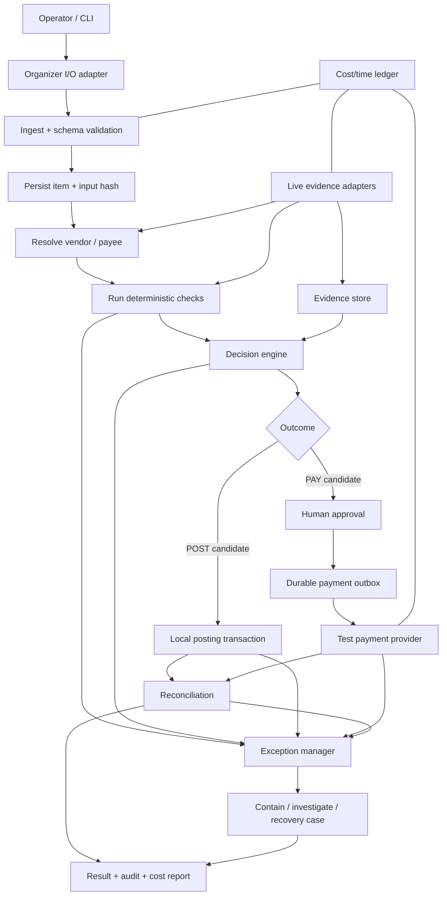

# PayPilot — Product Scope & Final Architecture

**Event:** ContextCon 05 · BITS Pilani · Buying & Paying  
**Status:** Team baseline — implementation target  
**Product form:** Python CLI, modular monolith, SQLite  
**Primary design goal:** prevent, detect, contain, investigate and safely recover from payment errors.

> **Document precedence:** official problem statement / organizer kickoff kit > `INTERFACES.md` assumptions > this architecture > task estimates. The actual kickoff kit is not yet confirmed in the materials reviewed. When it is available, its I/O contract wins. Record every change in `docs/CONTRACT_CHANGES.md`.

---

## 1. What we are building

**PayPilot is an accounts-payable operations agent for a mid-size Indian 3PL.** It processes bank lines and invoices, but its differentiating capability is reliable exception management: it prevents incorrect or duplicate actions, detects discrepancies, survives crashes, and manages the follow-up when an external financial action may already have happened.

The product must never:
- guess a payee or bank-account owner;
- silently pay or post the same logical item twice;
- retry an external payment when its outcome is uncertain;
- treat a provider success response as proof that the bank settlement is correct;
- claim that money was recovered merely because a recovery case was opened.

Every decision must be explainable from client records or a cited live source. Unknown or conflicting evidence means `CANNOT_VERIFY` or `HELD`, not a guess.

### The two core operations remain separate

1. **`POST_BANK_LINES`** — classify bank statement lines and create a local posting/export record. This does not move money.
2. **`PAY_INVOICES`** — validate invoices, match vendor/PO/payment records where supplied, obtain human approval, and submit a test-mode provider action.

A bank debit line is not a payment instruction. `POSTED` is not `PAID`.

### Product promise

> Every item ends in a sourced result, a safe hold, or an explicit cannot-verify outcome. Every attempted side effect is recorded and reconciled. Exceptions remain visible until resolved.

---

## 2. What is official vs. assumed

### Event requirements from the team's official brief
- Buying & Paying: pay invoices exactly once, through crashes and bank-detail fraud; reconcile against a bank statement where available.
- The fictional client is a mid-size Indian 3PL; client records, requests and required I/O format are in the organizer kickoff kit.
- At least one decision must use live real-world data.
- Hidden cases include a duplicate, a lookalike and an unanswerable case; the correct response to the latter is cannot verify.
- Every output fact needs the exact source record/field or passage and record date. No model-memory facts.
- Irreversible actions require human approval. Payments must be in test mode.
- Every run has time and cost limits; every external call is cost-recorded.
- Required deliverables: README, architecture diagram, code and a working CLI. Screening includes unseen input and process stop/restart; finals include a judge killing the process and a live change request.

### Current design assumptions (must be checked against kickoff kit)
- Python CLI, Pydantic schemas, SQLite WAL, one process lock.
- Internal development fixtures use JSON transaction files and CSV master data.
- Stripe test mode is the first payment adapter; FakeProvider is for deterministic crash tests.
- Razorpay IFSC lookup is the minimum live-data path if still available and suitable.
- The official four bank-line case is retained as a regression fixture.
- PO, statement and payment-history checks run only when the corresponding input exists. Missing optional input is `SKIPPED`, never a pass.
- The product is single-client for the hackathon. Tenant columns do not imply multi-tenant isolation.

The kickoff kit overrides all provisional filenames, schemas and output fields.

---

## 3. End-to-end workflow



Exception management is **cross-cutting**, not merely the last box in the pipeline. Every stage can emit an exception. A blocking exception prevents downstream side effects.

### Stage responsibilities

1. **Ingest:** parse structured input deterministically; validate required fields; normalize money to integer paise; retain raw input reference/hash. LLM/OCR is optional and only used if the kit contains unstructured documents.
2. **Resolve:** match client vendor master first. Prefer stable identifiers and exact aliases. Fuzzy matching may suggest a candidate but cannot independently authorize payment.
3. **Check:** run required-field, duplicate, PO, account, bank-change, source-availability and reconciliation checks supported by supplied data.
4. **Decide:** pure deterministic rules produce outcome, flags, reasons, missing evidence and source references. The LLM never decides whether to pay.
5. **Approve:** show payee, amount, bank last-four, checks, exceptions and evidence. Approval binds to the exact `decision_hash`; material changes invalidate it.
6. **Execute:** write a durable outbox record before provider side effects. Use stable provider idempotency keys. Persist provider references and reconcile before retrying.
7. **Reconcile:** compare intended action, provider state and bank/statement state when available. A provider success is not the same as bank settlement or recovery.
8. **Manage exceptions:** classify severity, contain unsafe work, retain evidence, request human action and track resolution.
9. **Report:** organizer-format output plus operator report, audit events, exception register and per-call cost ledger.

---

## 4. Exception-management design

### Exception record

Every meaningful failure, discrepancy or suspicious condition becomes a durable `Exception` record, not just a log line.

Minimum fields:
- `exception_id`, `run_id`, `item_id`, optional `payment_id`;
- `type`, `severity`, `status`;
- `summary`, `details`, `recommended_action`;
- `evidence_refs[]`, `related_entity_refs[]`;
- `created_at`, `updated_at`, `assigned_to`;
- `resolution_code`, `resolution_note`, `resolved_by`, `resolved_at`.

### Severity

- `CRITICAL`: wrong-payee/wrong-account payment, possible duplicate payout, confirmed unauthorized or materially incorrect external action. Stop related payment work and escalate.
- `HIGH`: bank-change request, duplicate invoice/payment candidate, amount mismatch, uncertain provider outcome, conflicting settlement evidence. Block the affected action.
- `MEDIUM`: missing PO, account mapping issue, source unavailable after retries, stale vendor data. Hold the affected item.
- `LOW`: non-blocking data-quality warning or informational discrepancy. Record and report.

Severity never overrides the policy outcome. A `CANNOT_VERIFY` or never-overridable fraud flag cannot be approved away.

### Exception lifecycle

`DETECTED → CLASSIFIED → CONTAINED → INVESTIGATING → ACTION_REQUIRED → RESOLVED`

Alternative terminal states: `FALSE_POSITIVE`, `ACCEPTED_RISK` (only if policy permits and a human records why), `CLOSED_NO_ACTION`.

- `CONTAINED` means the risky action is blocked; it does not mean the financial issue is fixed.
- `RESOLVED` requires evidence of the resolution, not merely an operator clicking close.
- Reopening an exception creates an audit event and preserves its history.

### Payment lifecycle is separate

Suggested states:
`CREATED → AWAITING_APPROVAL → APPROVED → SUBMITTED → PROVIDER_CONFIRMED`

Alternative states:
`REJECTED`, `FAILED`, `PAYMENT_UNCERTAIN`, `RETURNED`, `REVERSED`, `RECOVERY_PENDING`, `RECOVERED`.

A payment can be provider-confirmed while its exception remains open (for example, it was sent to the wrong vendor). Do not collapse payment and exception state into one enum.

### Recovery is compensation, not rollback

Once an external payment has been accepted, a local database rollback cannot undo it. PayPilot should:
1. stop further related payments;
2. preserve provider references, decision, approval and evidence;
3. open a recovery exception/case;
4. prepare the appropriate human-reviewed next step (contact provider/bank/vendor, request return/refund, adjustment);
5. track the request and external confirmation;
6. mark `RECOVERED` only when there is evidence funds were actually returned/credited.

Do not claim automated refunds or bank reversals unless the chosen provider actually supports and the implementation demonstrates that operation. In this hackathon, a documented recovery case and tracked status is acceptable if real recovery rails are unavailable.

---

## 5. Critical financial correctness rules

### Exactly-once claim (precise wording)

One logical payment instruction produces **at most one successful external provider action**, across duplicate inputs, repeated approvals, crashes and restarts. If provider outcome cannot be established, stop at `PAYMENT_UNCERTAIN` and reconcile. A local DB and remote provider cannot participate in one atomic transaction; the design relies on durable outbox, stable provider idempotency and reconcile-before-act.

Never claim mathematical distributed exactly-once delivery.

### Idempotency
- Stable key derives from logical payment identity: tenant/client, vendor, canonical invoice number, amount in paise and currency.
- Do not include approval ID or a retry/version counter in the key.
- Unique constraints protect local payment/outbox records.
- If provider idempotency retention may have expired and outcome is unknown, fail closed and require manual reconciliation; do not create a new key just to retry.

### Approval
- Every payment requires a human approval.
- Approval binds to `decision_hash`; changed invoice, vendor, bank data, amount, policy or evidence invalidates it.
- Bank-change, unresolved identity, duplicate invoice and uncertain payment are not overridable.
- `POST_BANK_LINES` creates only a local posting. If later integrated with an external accounting system, treat that as an irreversible action and require approval.

### Bank evidence
Show three separate statuses:
- `ifsc_valid`: bank/branch metadata lookup succeeded.
- `account_matches_master`: supplied account fingerprint matches the vendor master.
- `ownership_verified`: `NOT_VERIFIED` unless a genuine ownership-verification source exists.

IFSC validity does not prove account ownership. Never store/log full account numbers; use HMAC/fingerprint plus last four where appropriate.

### Provider semantics
Stripe PaymentIntent is a **test card-charge simulation**, not a vendor bank payout. The README, CLI and demo must say exactly what the adapter does. Use a genuine payout adapter only if it is activated and verified.

---

## 6. Persistence, audit and recovery

SQLite:
- WAL mode, `synchronous=FULL`, foreign keys on;
- single-instance process lock;
- explicit state machine with compare-and-swap version;
- unique keys for item identity, approvals, payment idempotency and ledger call keys;
- audit event written in the same transaction as each local state transition.

Persist before side effects:
1. decision and decision hash;
2. approval record;
3. outbox/payment attempt record with idempotency key;
4. provider response/reference;
5. reconciliation result.

On startup and `resume`:
- acquire process lock;
- mark stale in-flight external calls as `UNCONFIRMED`;
- reconcile every submitted/uncertain payment with provider before new work;
- resume only safe pending steps;
- never replay a completed local posting or successful provider action.

Use a deterministic FakeProvider with kill injection to test crash points. FakeProvider is not evidence of real payment provider semantics.

---

## 7. Evidence, live data and cost

Every factual output field should link to a `Source`:
- provider/source name and record ID or URL;
- exact field or passage;
- source record date and `record_date_basis`;
- `retrieved_at`;
- limitations / self-published / confidence label.

Retrieval timestamp is not the record's publication/update date. A company website's own CIN/legal-name text is self-published evidence, not independent registry verification. Crustdata name-only matching is not reliable for legal identity; use domain only when the domain is actually known and relevant. IFSC lookup proves branch metadata only.

Cost/time ledger:
- reserve each external call before execution;
- confirm/fail/cache-hit after response;
- on crash, reserved-but-unconfirmed calls remain conservatively chargeable;
- record provider, operation, call key, estimated/actual cost, duration, status and linked item;
- unknown price is `null`/`UNKNOWN`, never ₹0;
- stop safely at time/cost limits and report partial completion.

---

## 8. CLI contract (command names may be adapted)

```bash
python -m paypilot run --request PATH
python -m paypilot resume --run RUN_ID
python -m paypilot approvals --run RUN_ID
python -m paypilot approve ITEM_ID --by "Finance Controller"
python -m paypilot reject ITEM_ID --by "Finance Controller" --reason "..."
python -m paypilot show ITEM_ID
python -m paypilot exceptions --run RUN_ID
python -m paypilot exception EXCEPTION_ID
python -m paypilot resolve-exception EXCEPTION_ID --by NAME --resolution CODE --note "..."
python -m paypilot report --run RUN_ID
python -m paypilot ledger --run RUN_ID
python -m paypilot export --run RUN_ID --out PATH
```

Minimum commands for the first working slice: `run`, `show`, `approvals`, `approve`, `resume`, `report`, `ledger`. Exception-specific commands can be added after the exception register is persisted; they should not delay the critical payment safety path.

---

## 9. Repository layout

```text
paypilot/
  __main__.py
  cli/
  core/              # config, DB, locks, state machine, audit, IDs
  kitio/             # only organizer-specific I/O adapter
  ingest/
  resolve/           # vendor resolution + live source adapters
  checks/            # duplicate, PO, bank, reconciliation checks
  decide/            # deterministic policy engine
  approvals/
  payments/          # provider interface, outbox, idempotency, executor
  exceptions/        # exception schema, manager, lifecycle, recovery cases
  reconciliation/    # matching + provider/bank reconciliation
  reports/
  ledger/
tests/
  contract/
  unit/
  integration/
  crash/
  fixtures/
docs/
  CONTRACT_CHANGES.md
```

Keep a modular monolith. No dashboard, microservices, queue platform or multi-agent runtime in the critical path. Coding agents can be used as development tools; they are not product architecture.

---

## 10. Acceptance gates

**Gate A — official contract**
- Organizer input/output format is implemented exactly in `kitio/`.
- Official four bank lines produce the required outcomes.
- Missing required input fails clearly; optional absent files are marked skipped.

**Gate B — error prevention**
- Duplicate invoice and duplicate bank line held.
- Lookalike/tie/parent-brand mismatch cannot become a confident wrong vendor.
- Bank-change request blocked; ownership remains unverified.
- Unsettleable payee returns `CANNOT_VERIFY` and names missing evidence.

**Gate C — side-effect safety**
- Payment requires approval bound to current decision.
- Duplicate approval cannot create duplicate action.
- Timeout/uncertain provider outcome never triggers blind retry.
- Kill/restart at critical points yields at most one successful provider action and one local posting.

**Gate D — exception and recovery**
- Every blocking failure creates an exception with type, severity, evidence and next action.
- Wrong-payee/duplicate/amount-mismatch scenarios stop related work.
- A post-payment error opens a recovery case; recovery is not marked complete without evidence.
- Exception and payment lifecycles remain separate.

**Gate E — evidence and finance**
- At least one real live-data decision is demonstrated.
- Every claim has source field/passage and date basis.
- Per-call costs and run limits are visible; unknown prices are not represented as zero.

**Gate F — demo and handoff**
- Fresh-clone CLI demo works from README.
- Architecture diagram matches implemented code.
- Tests, logs, README, output, exception register and cost ledger are inspectable.
