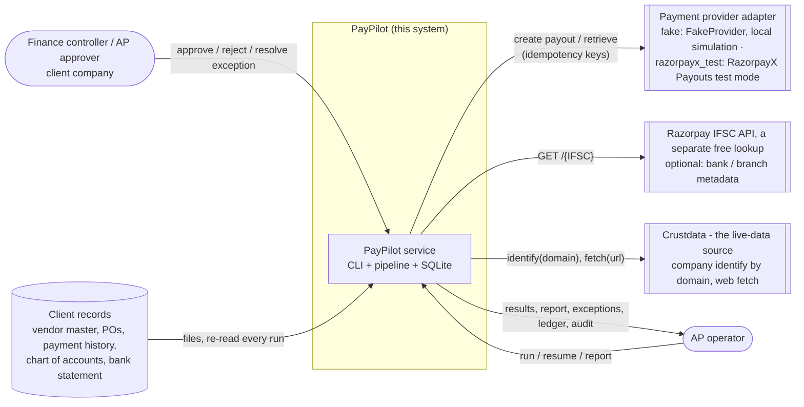
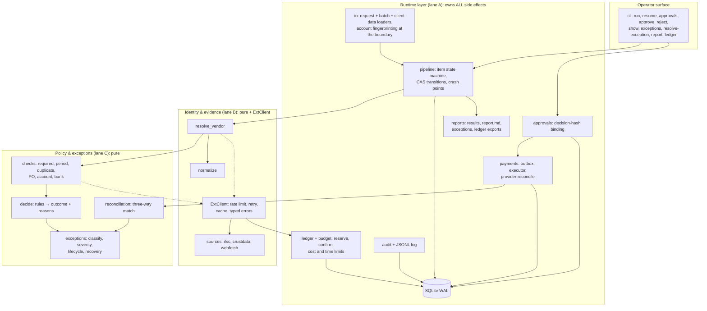
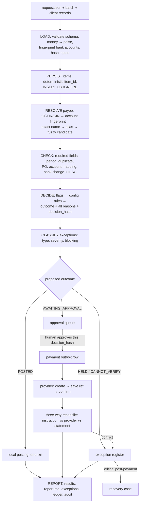
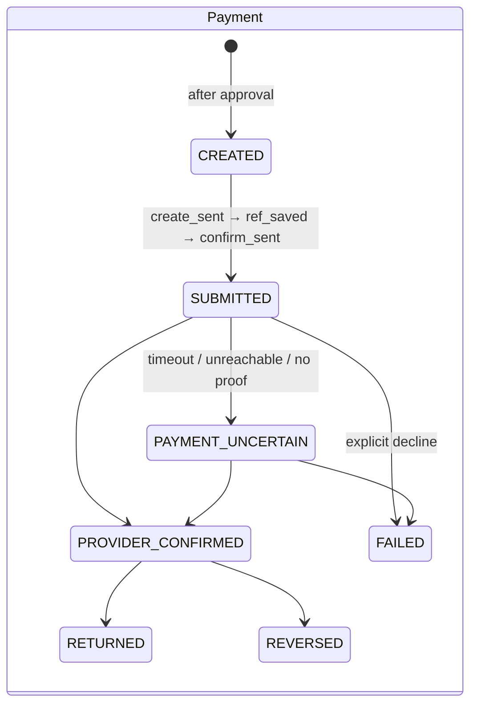
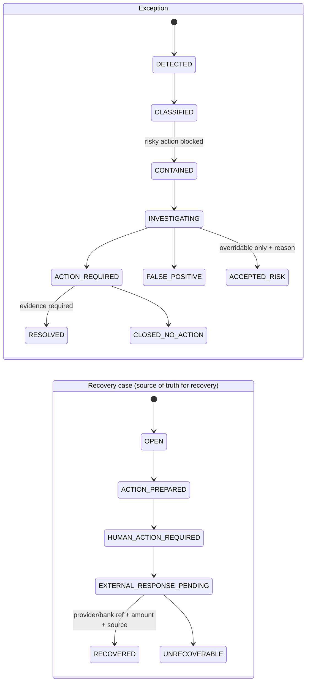
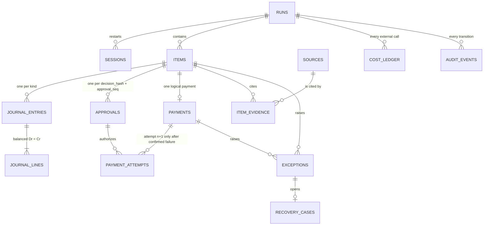
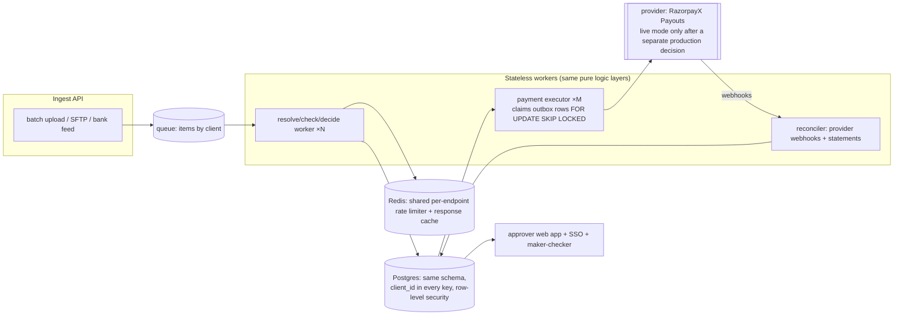

# PayPilot: System Architecture

> **PayPilot** is an autonomous bookkeeping and accounts-payable agent for mid-size Indian logistics (3PL) companies. It posts bank lines to the right payee and account, pays approved vendor invoices **at most once** (even through crashes), stops bank-detail fraud, reconciles against bank statements, and keeps **books an auditor can replay line by line**. Its core is **exception management**: knowing when *not* to proceed, explaining why, and giving a human the evidence to resolve it.
>
> **Priorities:** correct bookkeeping → vendor resolution and evidence → duplicate and fraud detection → exceptions and approvals → crash-safe state → reconciliation → audit report and CLI demo. A **RazorpayX Payouts test-mode** adapter (vendor payouts, not card charges) is P0 *if* test access is verified (TASKS A9); the FakeProvider stays the deterministic test target. **The payment provider is an implementation detail behind an interface.**
>
> **Status:** final design, planning phase. No code yet. Exact contracts are in [`INTERFACES.md`](INTERFACES.md), failure behaviour in [`FAILURE_MODES.md`](FAILURE_MODES.md), the demo world in [`SCENARIOS.md`](SCENARIOS.md).
> **Precedence:** `HACKATHON_INFORMATION.md` Part A (binding rules) > `docs/DECISIONS.md` > this file > the other docs. Earlier drafts are in git history only.

---

## 1. The product in one page

| | |
|---|---|
| **Job replaced** | The payables clerk / outsourced AP firm that matches bank lines and invoices to vendors, catches duplicates and bank-change fraud, gets approvals, pays, and chases errors. |
| **Customer (who pays)** | The finance controller of a mid-size 3PL (₹100–1,000 Cr revenue, hundreds of carriers and suppliers). Second segment: outsourced AP / BPO firms serving many 3PLs. This makes the architecture multi-client ready (§12). |
| **Input** | A **request** (post these bank lines / pay these invoices / reconcile this statement) plus a batch file, checked against the client's **own records**: vendor master (source of truth for legal name, GSTIN, CIN, bank account, IFSC), POs, payment history, chart of accounts. |
| **Finished result** | Every item ends in exactly one outcome: `POSTED`, `PAID` (the provider returned its documented successful terminal payout status, after human approval), `HELD` (with reasons), `CANNOT_VERIFY` (what is missing is named), `REJECTED`, or `PAYMENT_UNCERTAIN` (stop and reconcile). Every blocking issue is a durable **exception**; wrong payments open a **recovery case**. Every fact cites its source, and every external call is in the cost ledger. |
| **Product promise** | Never guess who to pay. Never pay the same invoice twice, even through crashes. Never take an irreversible action without a human. Keep every problem visible until it is resolved with evidence. |
| **Pass mark** | All scenarios in `SCENARIOS.md` produce their expected outcomes, asserted against the **database, output files and audit log**; the kill -9 loop yields ≤ 1 successful provider payment per invoice; `audit verify` replays every decision and balances the books; every output fact has a source. |

**What PayPilot deliberately is not:** an LLM that decides payments; a bank; a proof of account ownership; a dashboard product (the operator surface is a CLI plus generated reports); a distributed system (yet, see §12).

---

## 2. System context (C4 level 1)



**Trust boundaries:**
1. The **client's records** are trusted as the source of truth for vendor identity and bank details, but are still validated (duplicates and conflicts inside the vendor master are exceptions).
2. **Live sources** are evidence of specific facts only: IFSC → bank and branch; Crustdata → the company behind a domain; a company website → a self-published claim.
3. **Batch input** (bank lines, invoices, vendor emails) is untrusted. A changed bank account in an invoice is treated as possible fraud.
4. The **payment provider** is the only system that can move money. We never assume what it did; we ask it. PayPilot works against the `PaymentProvider` interface: a **FakeProvider** with its own durable store (it simulates success, decline, timeout, and "accepted just before we crashed") is the default and the test target. The real test-mode provider is **RazorpayX Payouts in test mode** (`razorpayx_test`): its sandbox simulates a vendor payout with a dummy balance and moves no real money. It is not the Razorpay Payment Gateway, and Payment Links are never used as payouts. FakeProvider is our own simulation, not a provider sandbox. RazorpayX live mode is unsupported: live keys are refused and there is no fallback between providers.
5. **No LLM.** All inputs are structured CSV/JSON; every decision is deterministic code.

---

## 3. Containers and components (C4 level 2–3)

PayPilot is a **modular monolith**: one Python 3.11 process, one SQLite database (WAL), and three clearly bounded layers. The key design rule:

> **Decision logic never causes side effects. Everything that writes, calls out, or moves money lives in one runtime layer, and that layer is the one the crash tests target.**



| Layer | Modules | Owner | Rule |
|---|---|---|---|
| Runtime | `core/ io/ cli/ approvals/ payments/ ledger/ reports/` | Lane A | The only code that touches SQLite, the payment provider, files and locks |
| Identity & evidence | `resolve/ sources/` | Lane B | Pure functions. Network only through `ctx.ext`. Writes (cache, ledger) only through ports the runtime provides |
| Policy & exceptions | `checks/ decide/ exceptions/ reconciliation/` | Lane C | Pure functions. Reads history only through `ctx.history` (read-only). Returns drafts; the runtime persists them |

Why this split: the exactly-once property can be proven by testing one layer. The logic layers are fully unit-testable with fakes. And the three lanes can be built in parallel against a frozen contract.

---

## 4. Request lifecycle



| Stage | Does | Never does |
|---|---|---|
| Load | Strict schema validation; money as integer paise; account numbers → HMAC fingerprint + last 4 at the boundary | Store a raw account number |
| Resolve | Client vendor master first; live lookups only when an identifier (domain, GSTIN) exists | Identify by name via Crustdata; merge lookalikes; pick a winner in a tie |
| Check | Every check returns PASS / FAIL / SKIPPED / ERROR / UNKNOWN with evidence | Treat a source error or missing optional file as PASS |
| Decide | Pure function of normalized facts + policy; collects **all** reasons | Use an LLM; stop at the first flag |
| Approve | Shows payee, amount, account last 4, three bank statuses, reasons, sources; binds to `decision_hash` | Approve a stale decision; override a never-overridable flag |
| Execute | Persist intent → call provider with an idempotency key → persist the result → write the balanced journal entry | Retry blindly; infer success or failure from silence |
| Reconcile | Compares what we intended, what the provider did, what the bank shows | Call "provider-confirmed" "settled" |

**Three separate events, never interchangeable:**

| Event | Where recorded | Means | Does **not** mean |
|---|---|---|---|
| Local posting | item `POSTED`; journal `BANK_LINE_POSTING` / `INVOICE_ACCRUAL` | PayPilot wrote a balanced entry in its own books | Any money moved |
| Provider-confirmed payout | payment `PROVIDER_CONFIRMED` → item `PAID`; journal `INVOICE_PAYMENT` (Cr Bank – payments clearing) | The provider returned its **documented successful terminal status** (RazorpayX `processed`; FakeProvider `SUCCEEDED`) | Bank settlement. In RazorpayX test mode it also means no real money moved |
| Bank settlement | `payments.settlement_status` (`MATCHED` …), from a supplied bank statement (§4 Reconcile) | The bank statement shows the debit | — |

An item is **never** `PAID` because it was approved, a payout request was sent, the provider acknowledged it (RazorpayX `queued` / `pending` / `scheduled` / `processing`), or an export file was written. Until a terminal status arrives the item stays `PAYMENT_IN_PROGRESS` (payment `SUBMITTED`) and every `run` / `resume` re-polls it. The status mapping is in INTERFACES §8.

---

## 5. Exactly-once payments (the core robustness argument)

**What we claim:** one logical payment instruction produces **at most one successful provider action**, across duplicate inputs, repeated approvals, crashes, restarts and timeouts. If the outcome cannot be established, the payment stops at `PAYMENT_UNCERTAIN` and is reconciled, never resent. A local database cannot commit atomically with an external provider, so we don't claim distributed atomic exactly-once.

**How:**
1. **Two keys:**
   - The **logical payment key** = hash(client, vendor, canonical invoice no., amount, currency). It never changes and has a local UNIQUE constraint.
   - The **provider attempt key** = logical key + `:a<n>`. Attempt *n+1* is allowed only after the provider has *confirmed* that attempt *n* was declined before success, and only with a fresh approval. A reversal after confirmed success is never retried: it reverses the journal entry, opens a CRITICAL recovery exception and contains the vendor. (RazorpayX documents that a payout in a failed state means every request with that idempotency key has failed, and that retrying with a fresh key while the first is still processing can pay twice. So a new attempt key comes only after a provider-confirmed terminal failure.)
2. **Outbox:** the payment row is committed *after* approval and *before* any provider call.
3. **Provider call, recorded step by step:** `create` → **persist the provider ref** → `confirm`. Each step has its own provider idempotency key, and a `step` column records which call may have landed. FakeProvider uses a real two-step create/confirm. RazorpayX creates and initiates the payout in **one** call (`POST /v1/payouts`, header `X-Payout-Idempotency`). Its `confirm()` makes no money-moving call: it only retrieves status (INTERFACES §8).
4. **Reconcile before acting:** every `run`, `resume` and `approve` reconciles open payments with the provider *before* any new work.
5. **Fail closed:** if the provider is unreachable, returns an unrecognised status, or the replay window has passed (RazorpayX: 24 h configured; the claimed 168 h key validity (UNVERIFIED: official source not yet checked)) and no lookup can prove the outcome, the payment becomes `PAYMENT_UNCERTAIN` with an exception. A person reconciles it. **An empty search is never treated as permission to pay again.**
6. **Containment:** while a CRITICAL payment exception is open for a vendor, no new payment to that vendor can be queued.

```mermaid
sequenceDiagram
  autonumber
  actor Approver
  participant CLI as PayPilot CLI
  participant DB as SQLite (WAL)
  participant ST as Payment provider (FakeProvider shown; RazorpayX test differs as noted)
  Approver->>CLI: approve ITEM --by "Controller"
  CLI->>DB: txn: approval APPROVED (decision_hash) + payment CREATED + audit
  CLI->>DB: step=create_sent
  CLI->>ST: create payment (idempotency key derived from K:a1:create)
  Note over CLI: kill -9 here (response lost)
  Approver->>CLI: resume
  CLI->>DB: open payments? → step=create_sent, no ref
  CLI->>ST: create again with SAME key
  ST-->>CLI: same payment ref_123 (replayed, no new payment)
  CLI->>DB: provider_ref=ref_123, step=ref_saved
  CLI->>DB: step=confirm_sent
  CLI->>ST: confirm ref_123 (FakeProvider) / retrieve status (RazorpayX)
  ST-->>CLI: documented successful terminal status
  Note over CLI,ST: RazorpayX acknowledged statuses (queued, processing…) keep the payment SUBMITTED; resume re-polls
  CLI->>DB: txn: payment PROVIDER_CONFIRMED + item PAID + audit
  CLI->>CLI: three-way reconcile → settlement PENDING (no statement yet)
```

Every crash point and its recovery is in [`FAILURE_MODES.md`](FAILURE_MODES.md) §3.

---

## 6. State machines (three independent lifecycles)

A payment can be provider-confirmed while its exception is still open (for example, it went to the wrong vendor). So item, payment and exception states are **separate**.

```mermaid
stateDiagram-v2
  direction LR
  [*] --> NEW
  NEW --> PARSED
  PARSED --> RESOLVED
  RESOLVED --> CHECKED
  CHECKED --> DECIDED
  DECIDED --> POSTED: proposed POSTED (local journal)
  DECIDED --> AWAITING_APPROVAL: payment candidate
  DECIDED --> HELD
  DECIDED --> CANNOT_VERIFY
  AWAITING_APPROVAL --> APPROVED
  AWAITING_APPROVAL --> REJECTED
  HELD --> APPROVED: overridable flags only + reason
  HELD --> REJECTED
  APPROVED --> PAYMENT_IN_PROGRESS
  PAYMENT_IN_PROGRESS --> PAID
  PAYMENT_IN_PROGRESS --> PAYMENT_UNCERTAIN
  PAYMENT_IN_PROGRESS --> FAILED
  PAYMENT_UNCERTAIN --> PAID: reconcile evidence
  PAYMENT_UNCERTAIN --> FAILED: reconcile evidence
  FAILED --> HELD: fresh checks + approval before retry
  POSTED --> [*]
  PAID --> HELD: reversed/returned after success (REVERSAL entry + CRITICAL recovery case; no retry)
  PAID --> [*]
  REJECTED --> [*]
  CANNOT_VERIFY --> [*]
```







**Rules:**
- Every transition is compare-and-swap on `(state, version)`, with an audit event written in the **same transaction**.
- A change to client data or decision policy moves non-final items to `STALE` → re-decided. A pending approval whose `decision_hash` no longer matches is `SUPERSEDED`.
- `PAID`, `POSTED`, `REJECTED` and `CANNOT_VERIFY` are never re-run. The one exit from `PAID` is a provider-reported reversal after success, which goes to `HELD` for a human-led recovery and is never paid again automatically.

---

## 7. Data model



The full DDL, with every UNIQUE constraint that enforces "at most once", is in [`INTERFACES.md`](INTERFACES.md) §6.

### 7.1 Books an auditor can replay
- **Double-entry journal.** Every financial effect is one balanced journal entry (Σ debit = Σ credit):
  - Bank-line posting: Dr *expense account* / Cr *Bank*.
  - Approved invoice paid: Dr *Accounts payable – vendor* / Cr *Bank – payments clearing*.
  - Invoice accepted for payment: Dr *expense account* / Cr *Accounts payable – vendor*.
  - Each entry links to the item, its `decision_hash`, its approval (if any) and its payment attempt.
- **Policy snapshot per run.** The exact merged config and policy, plus the client-data hash, are stored on the run row.
- **`audit verify`** replays the run line by line from the database alone:
  1. Re-runs `decide()` on the stored facts and policy snapshot → the same `decision_hash` for every item.
  2. Every reversed payment has exactly one INVOICE_PAYMENT and one REVERSAL entry, plus a CRITICAL exception with a recovery case. Every PAID item has one confirmed provider attempt, linked to an APPROVED approval with the matching hash, and one payment journal entry. Every attempt n > 1 has its own, later approval (`approval_seq` n) and follows a provider-confirmed failure of attempt n−1.
  3. No payment key has more than one confirmed attempt.
  4. Every journal entry balances, and the trial balance sums to zero.
  5. Every state change has an unbroken audit-event chain.
  6. Every fact in the output resolves to a stored source.

  Any failure is reported as an exception. This is the deliverable an auditor (and a judge) can run.

| Guarantee | Enforced by |
|---|---|
| One item row per input row | `items.item_id` deterministic + `UNIQUE(run_id, input_name, row_no)` |
| One journal entry per item and kind | `journal_entries UNIQUE(item_id, kind)` |
| One approval per decision (per retry) | `approvals UNIQUE(item_id, decision_hash, approval_seq)`; seq n+1 only after a provider-confirmed failure |
| One logical payment per invoice | `payments.payment_key UNIQUE`, `payments.item_id UNIQUE` |
| One provider attempt key per attempt | `payment_attempts.attempt_key UNIQUE` |
| One exception per cause | `exceptions UNIQUE(subject_id, type, origin_key)` |
| One ledger row per call attempt | `cost_ledger.call_key PRIMARY KEY` |

---

## 8. Evidence model ("every fact has a source")

Every factual claim in the output is a `Source`:
- provider and record reference
- the **exact field or quoted passage** (for passages, the value must appear in the quote)
- `record_date`: a date the source itself supplies for the record, with its **basis** (`RECORD_FIELD`, `PUBLICATION_DATE`, `FILE_METADATA`, or `UNKNOWN` with `record_date = null` when the source gives none; we never invent one)
- `retrieved_at`: when PayPilot retrieved it. The HTTP `Date` response header, or our clock, sets **only** this field. It is never a record date.
- its limitations

| Source | Proves | Does **not** prove |
|---|---|---|
| Client vendor master | Legal name, identifiers, approved bank account, default account (as of its `last_updated`) | That the vendor still uses that account |
| Razorpay IFSC | The IFSC exists and maps to a bank and branch (no record date; `retrieved_at` from the HTTP `Date` header) | Who owns an account at that branch |
| Crustdata Identify (by domain) | A company is associated with that domain | The legal entity that issued the invoice (it often returns the parent brand) |
| Company website passage | The website **claims** a legal name / CIN (self-published) | Registry status |
| Payment provider (FakeProvider, or RazorpayX test mode) | The provider's status for the payout (RazorpayX `pout_…` id, `status`, `utr` if present; `created_at` as `RECORD_FIELD`) | Real money movement (test mode uses a dummy balance) or bank settlement. FakeProvider output is our own simulation |

Bank verification is always shown as **three separate statuses**: `ifsc_valid`, `account_matches_master`, `ownership_verified` (always `NOT_VERIFIED`, because no source we use proves ownership).

Rendered example: *"Payee **Swiggy Limited**, from the `legal_name` field of vendor-master record V-0001 (record dated 30 Sep 2026), retrieved 22 Nov 2026 14:03 IST."*

---

## 9. Exception management (the differentiator)

Every meaningful failure, discrepancy or suspicious condition becomes a durable `Exception` record. A log line is not enough.
- **Severity rule:** `CRITICAL` = money may already be wrong (duplicate payout, wrong payee, wrong amount, duplicate debit). `HIGH` = an unsafe action was blocked *before* payment (bank change, duplicate invoice, ambiguous identity, uncertain provider outcome). `MEDIUM` = an item is held for missing or unavailable data. `LOW` = an informational warning.
- **Containment first:** blocking exceptions stop the related action. A CRITICAL one also blocks new payments to the same vendor.
- **Recovery is compensation, not rollback:** a confirmed external payment cannot be undone by a local transaction. PayPilot opens a recovery case with a prepared human action (contact provider/bank/vendor, request a return) and tracks it. It marks the case `RECOVERED` **only** with a provider or bank reference, the amount and a source.
- **Never overridable:** unresolved, tied, lookalike or parent-brand identity; bank change or invalid IFSC; duplicate invoice or payout; uncertain provider outcome; missing required fields; persistence failure.

The full matrix is in [`FAILURE_MODES.md`](FAILURE_MODES.md).

---

## 10. Cost, limits and observability
- **Cost ledger:**
  - A row is **reserved before** every external call (Crustdata, IFSC, payment provider), then confirmed, failed or marked a cache hit.
  - After a crash, reserved rows become `UNCONFIRMED` and still count, so spend is never under-reported.
  - Credits and tokens are converted to ₹ via config. An unknown price is reported as `UNKNOWN`, never ₹0.
- **Limits:** a per-run time limit and cost limit; the stricter of the request's and the client policy's applies.
  - Hitting the cost limit → no more paid calls; the remaining items are held with `COST_LIMIT`; run status `STOPPED_COST`.
  - Hitting the time limit → run status `PARTIAL`; `resume` continues.
- **Measured unit economics:** `ledger` shows ₹ per item, ₹ per finished item, the worst item, the cache-hit rate, and the share of items resolved at ₹0 from the vendor master.
- **Observability:**
  - An append-only `audit_events` table, written in the same transaction as each state change, is the source of truth.
  - A JSONL log per run is the readable copy. A new `session_id` on each restart makes crash recoveries visible.
  - `show <item>` prints the chain **decision → rule → flag → check → evidence → source**.

---

## 11. Key design decisions (options considered)

| # | Decision | Chosen | Alternatives | Why / trade-off |
|---|---|---|---|---|
| 1 | Form factor | CLI modular monolith | LLM agent loop; web app + dashboard; microservices | Deterministic, crash-testable, buildable in 7 h. Trade-off: no GUI (generated reports instead) |
| 2 | Layering | Pure logic layers + one side-effect runtime | Each module persists its own state | Exactly-once is provable in one place; logic is unit-testable |
| 3 | Store | SQLite WAL, `synchronous=FULL`, single-instance lock | Postgres; JSON files | Atomic multi-row transactions, zero setup. Trade-off: one writer (fine now; Postgres at scale) |
| 4 | Lifecycles | Item, payment, exception and recovery as separate machines | One merged enum | A payment can succeed while its exception stays open |
| 5 | Payment identity | Logical key + provider attempt key | Approval- or version-suffixed keys; DB-only uniqueness | No override, retry or restart can create a second success, yet a confirmed failure can still be retried safely |
| 6 | Provider | `PaymentProvider` interface; **FakeProvider** (durable, fault-injecting) is the deterministic test target; **RazorpayX Payouts test mode** is the real provider adapter (`razorpayx_test`). Live mode unsupported | *Discarded:* Stripe PaymentIntents (charges a customer's card; not a vendor payout); Razorpay Payment Gateway / Payment Links (collect money, don't pay vendors); FakeProvider only (not a real provider) | PayPilot pays vendors, so the provider operation must be a payout. Correctness is still proven on the FakeProvider, so no test depends on credentials |
| 7 | Identity | Client master first; Crustdata by **domain** only; tie / lookalike / parent brand → CANNOT_VERIFY | Name-based lookup; embeddings or an LLM judge | Probes showed 3 different "Sharma Traders" at confidence 1.0. A wrong payee is worse than "cannot verify" |
| 8 | Decisions | Flags → declarative rules in config → all reasons | Rules DSL / eval; LLM | Reproducible `decision_hash`; explainable; same facts → same answer |
| 9 | Decision hash | Normalized facts + decision-policy config only | Hash everything, including evidence timestamps | Re-fetching a source or editing output config doesn't silently invalidate approvals |
| 10 | Exceptions | Durable register + recovery cases | Logs | Problems stay visible and owned until resolved with evidence |
| 11 | Config | `config.yaml` (product defaults) + `clients/<id>/policy.yaml` (client rules), strict schema, hashed, re-read every run | Constants in code | A requirement change is a 1–2 line edit; a second client is a new folder |
| 12 | LLM | **None.** Structured CSV/JSON, deterministic parsing | LLM extraction or decisions | Financial decisions must be deterministic, cheap and reproducible |

---

## 12. Scaling to 100× and to many clients (design answer)



**What changes and what stays:**
- The pure logic layers, contracts, state machines, idempotency keys and reconcile-before-act stay **unchanged**. That's the payoff of the layering.
- The runtime layer is swapped: SQLite → Postgres; the single loop → queue workers; polling → provider webhooks; the CLI approver → a web app with SSO and maker-checker (two-person approval above a ₹ threshold).
- **Multi-client:**
  - `client_id` is already on every row and every key.
  - Each client gets `clients/<id>/` (vendor master + policy).
  - At scale: composite `(client_id, id)` keys, row-level security, per-client secrets and per-client cost limits.
- **Cost at volume:** vendor-master hits cost ₹0. External lookups are cached per client and domain, and Crustdata Identify can be batched (up to 25 domains per call).

---

## 13. Security, privacy and ethics by design
- **Data minimization:**
  - Only the needed vendor-master columns are loaded.
  - Bank account numbers become HMAC fingerprints (key in `.env`) + last 4 at load time; the full number is never stored or logged.
  - No data about individual people is stored.
  - No LLM is called, so no client text leaves the system except domain lookups to Crustdata and, for an approved payout in `razorpayx_test`, the payee's name, IFSC and account number sent to RazorpayX test mode (in memory only, never logged).
- **Human control:** every payment needs a named approver. Approvers come from the client policy's allowlist (`approvers:`); this is identity by declaration in the hackathon build, with SSO in production. Overrides need a written reason, and some flags can never be overridden.
- **Honest claims:**
  - The output never says "verified" when a source only *claims* something.
  - "Provider-confirmed" is never called "settled", and "recovery requested" is never called "recovered".
- **Secrets:** only in `.env`; with `razorpayx_test`, any key that isn't a test key (`rzp_test_` prefix) is refused at startup and the run prints `Payment provider: RazorpayX TEST MODE (no real money)`; secrets are never logged; test mode only.
- **Explainability:** every decision lists every reason, rule and source; `show` gives the full chain; decisions are reproducible from the recorded facts.

The buyer, pricing and the ethics narrative are in [`BUSINESS.md`](BUSINESS.md).

---

## 14. Repository layout

```text
paypilot/                     Python package
  __main__.py  schemas.py  context.py  flags.py  policy_config.py
  core/        config db state ids audit log lock crash budget history journal pipeline (A)
  io/          request batch client_data fingerprint                                   (A)
  cli/  approvals/  payments/  ledger/  reports/  audit/ (verify)                       (A)
  resolve/     normalize matcher                                                       (B)
  sources/     http crustdata webfetch ifsc                                            (B)
  checks/      required period duplicate po account bank runner                        (C)
  decide/      rules engine                                                            (C)
  exceptions/  classify lifecycle recovery                                             (C)
  reconciliation/ match                                                                (C)
clients/northbay/             demo client: vendor_master.csv, purchase_orders.csv,
                              payment_history.csv, chart_of_accounts.csv, policy.yaml
scenarios/<id>/               request.json + batch files + expected.jsonl (the demo world)
config.yaml   db/schema.sql   pyproject.toml   .env.example
tests/        contract/ unit/ integration/ crash/ fakes.py
docs/         ARCHITECTURE INTERFACES FAILURE_MODES SCENARIOS DEMO BUSINESS DECISIONS TASKS CONTRACT_CHANGES
var/ out/     (gitignored) database, cache, logs, run outputs
```
